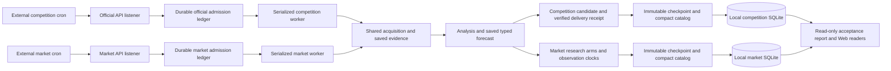

# Two-lane pipeline operations

## Contract

Both production lanes use the same acquisition engine. Their native platform
contracts, study clocks and delivery permissions remain independent.

## Completion evidence

1. Discovery success requires an explicit coverage report. Pagination gaps remain
   visible; a successful workflow does not establish platform-wide recall.
2. Admission requires a saved native identity, rules and original clock. A missing
   price or shallow book is an observation, not a market admission filter.
3. Worker handoff requires a matching automatic execution and a preserved queue.
   An active or queued worker is not a completed forecast. No duplicate dispatch.
4. Completed market work requires a saved original probability. Optional map arms
   can explicitly be unavailable. Original and supplementary materials retain
   their own capture clocks.
5. Competition delivery requires a timestamped platform receipt bound to the exact
   question and candidate payload. Historical unbound receipts stay unbound and
   must not be silently resubmitted.
6. Local ingestion requires a trusted catalog, exact hashes, successful transaction
   and persisted import watermark. A remote archive reference is not a local body.

## Independent, idempotent local ingestion

The hidden `ForecastAgent Market Data Sync` task runs both normalized mirrors.
Each database has its own lock, transactions and `latest-sync.json`. A market
failure does not starve the competition mirror. The combined command exits
nonzero on any domain failure, even if the other domain succeeded.

Content IDs identify immutable task payloads, forecasts, quotes and references.
Receiving identical content with another publication clock preserves the first
record and writes a `replication_receipts` observation. A reference with another
archive location preserves both locations. Changed content under the same identity
or an arbitrary conflicting ID is still rejected. No native quota is renewed.

`ForecastAgent Local Data Sync` separately archives missing original bytes by
SHA-256 and resumable ranges. Its catalog summary bound is 32 MiB, matching native
readers; source, manifest, embedding and expanded-archive bounds remain enforced.
Both PowerShell wrappers drain stdout/stderr before checking the native exit code.
Each lane gets its latest eligible catalog before historical catch-up; worker
body packs precede discovery caches. Verified file-index transactions commit in
batches of 64, with per-file savepoints and completed progress committed on a
transfer failure. A killed batch replays from existing verified SHA objects.
Aligned one-MiB cached blocks amortize tiny member requests. Signed URLs refresh
before their expiry; payload failures still wait for the next scheduled run.
The installed tasks use the base interpreter pythonw.exe with
`integrations/local_sync_runner.py`, executing the mirror in the scheduler-owned
process. A scheduler timeout cannot leave a detached PowerShell/Python writer.
Existing triggers, principals, limits and IgnoreNew settings remain unchanged.
The PowerShell wrappers remain compatible with manual Windows operation.

## Acceptance and recovery

Run `python -m ForecastAgent.pipeline_ops --root E:/metaculus_data` for a read-only
audit. The normalized sync also writes `E:/metaculus_data/pipeline-status.json`.
The report includes SQLite integrity, foreign keys, local sync age, import heads,
worker states, missing completed scores, receipt binding and body availability.
Pre-upgrade unbound receipt IDs are frozen once in database metadata. A new
accepted task without an exact bound receipt fails acceptance; it cannot silently
join the historical exemption on the next sync.

- `ok`: checked local invariants pass.
- `ok_with_gaps`: invariants pass, with pending work or explicit historical gaps.
- `failed`: database integrity, claimed completion, delivery binding or local sync
  health failed. A sync older than 90 minutes is stale; old worker checkpoints can
  still be legitimate when a listener confirms no due questions.

Preserve failed partial transfers and native ledgers. Retry imports without
recollecting evidence, reopening completed tasks, resetting budgets or resubmitting.
Freshness checks concern the local mirror, not forecast accuracy. Production
discovery, active worker and external cron cadence must be checked separately.

## Verification gates

The local-sync workflow runs on Linux and Windows without providers. Gates cover
interrupted range recovery, hash rejection, repeated publication, reference
provenance, cross-domain failure isolation, receipt equality and missing scores.
Real replay validation must preserve the entire original record prefix and add
zero records on an identical second replay before installing a new local runtime.
