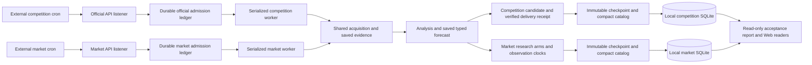

# Two-lane pipeline operations

## Contract

Both production lanes use the same acquisition engine. Their native platform
contracts, study clocks and delivery permissions remain independent.



## Completion evidence

1. Discovery success requires an explicit coverage report. Pagination gaps remain
   visible; a successful workflow does not establish platform-wide recall.
2. Admission requires a saved native identity, rules and original clock. A missing
   price or shallow book is an observation, not a market admission filter.
3. Worker handoff requires a matching automatic execution and a preserved queue.
   An active or queued worker is not a completed forecast. No duplicate dispatch.
4. Completed market work requires a saved original probability. Optional map arms
   can explicitly be unavailable. Original and supplementary materials retain
   their own capture clocks.
5. Competition delivery requires a timestamped platform receipt bound to the exact
   question and candidate payload. Historical unbound receipts stay unbound and
   must not be silently resubmitted.
6. Local ingestion requires a trusted catalog, exact hashes, successful transaction
   and persisted import watermark. A remote archive reference is not a local body.

## Independent, idempotent local ingestion

The hidden `ForecastAgent Market Data Sync` task runs both normalized mirrors.
Each database has its own lock, transactions and `latest-sync.json`. A market
failure does not starve the competition mirror. The combined command exits
nonzero on any domain failure, even if the other domain succeeded.

Content IDs identify immutable task payloads, forecasts, quotes and references.
Receiving identical content with another publication clock preserves the first
record and writes a `replication_receipts` observation. A reference with another
archive location preserves both locations. Changed content under the same identity
or an arbitrary conflicting ID is still rejected. No native quota is renewed.

`ForecastAgent Local Data Sync` separately archives missing original bytes by
SHA-256 and resumable ranges. Its catalog summary bound is 32 MiB, matching native
readers; source, manifest, embedding and expanded-archive bounds remain enforced.
Both PowerShell wrappers drain stdout/stderr before checking the native exit code.
Each lane gets its latest eligible catalog before historical catch-up; worker
body packs precede discovery caches. Within worker packs, the saved completion
clock puts newly scored cases before cold historical packs; this changes transfer
order only, never forecast inputs, study clocks or which files are retained. Verified file-index transactions commit in
batches of 64, with per-file savepoints and completed progress committed on a
transfer failure. A killed batch replays from existing verified SHA objects.
Aligned one-MiB cached blocks amortize tiny member requests. Signed URLs refresh
before their expiry; payload failures still wait for the next scheduled run.
The installed tasks use the base interpreter pythonw.exe with
`integrations/local_sync_runner.py`, executing the mirror in the scheduler-owned
process. A scheduler timeout cannot leave a detached PowerShell/Python writer.
Existing triggers, principals, limits and IgnoreNew settings remain unchanged.
The PowerShell wrappers remain compatible with manual Windows operation.

## Acceptance and recovery

Run `python -m ForecastAgent.pipeline_ops --root E:/metaculus_data` for a read-only
audit. The normalized sync also writes `E:/metaculus_data/pipeline-status.json`.
The report includes SQLite integrity, foreign keys, local sync age, import heads,
worker states, missing completed scores, receipt binding and body availability.
Pre-upgrade unbound receipt IDs are frozen once in database metadata. A new
accepted task without an exact bound receipt fails acceptance; it cannot silently
join the historical exemption on the next sync.

- `ok`: checked local invariants pass.
- `ok_with_gaps`: invariants pass, with pending work or explicit historical gaps.
- `failed`: database integrity, claimed completion, delivery binding or local sync
  health failed. A sync older than 90 minutes is stale; old worker checkpoints can
  still be legitimate when a listener confirms no due questions.

Preserve failed partial transfers and native ledgers. Retry imports without
recollecting evidence, reopening completed tasks, resetting budgets or resubmitting.
Freshness checks concern the local mirror, not forecast accuracy. Production
discovery, active worker and external cron cadence must be checked separately.

## P0: processing completion is not replay readiness

`pipeline_readiness.py` validates each selected saved snapshot independently of
the worker's completion flag. It checks frozen rules, exact selected input and
output binding, hash-verified native material objects, readable local source
bytes, source identities and capture clocks. A displayed score or an optional
map never substitutes for a missing original input. Zero probabilities remain
valid. Another route, revision or later capture cannot fill a missing binding.

Both normalized databases retain these derived tables:

| Table | Purpose |
| --- | --- |
| `replay_manifests` | Immutable content-addressed per-snapshot validation receipts, dependency hashes and explicit gaps |
| `replay_heads` | Latest checked receipt for each question; earlier receipts remain available |
| `pipeline_alerts` | Stable alert identity, first/last observation, resolution time and details |
| `pipeline_observations` (market) | Saved monitor discovery coverage and intake-health receipts |
| `native_recovery_receipts` (competition) | Original file-reference/hash and later local recovery time |

`replay_ready` means the recorded input can be replayed locally. It does not
establish factual relevance, causality, historical cutoff compliance, event
resolution or forecast accuracy. A live competition input may intentionally
have no retrospective cutoff. Its latest recorded capture is labeled as a
derived information clock, never as the question opening time. Historical
evaluation eligibility remains a separate check.

Missing raw objects, source timestamps, model bindings or readable bodies keep
the snapshot explicitly not ready. These are visible gaps and durable alerts;
they do not erase a saved forecast or stop other questions from being imported.
The acceptance report continues to distinguish database corruption and invalid
completion claims from recoverable material gaps.

## P0: repair saved originals, not historical facts

`python -m ForecastAgent.pipeline_recovery --root E:/metaculus_data` searches
only recorded task-pack locations and bounded trusted official worker archives.
Each recovered member must match its exact prior path, byte length and SHA-256.
Different historical hashes of one path remain different objects. No models,
searches, new website captures, submissions or budget resets are permitted.

Recovery defaults to a two-minute slice, 256 MiB of reserved uncompressed reads
(including unsuccessful reads) and twelve official archives. A large interrupted
pack resumes from cached one-MiB ranges on the next turn. Recovery has its own
owner lock and does not overwrite database records or original capture clocks.
Successful original bytes use the existing content-addressed object store.

The competition mirror revisits previously missing references even when the
catalog was already imported. It reconstructs bindings with that same source's
original files and observation time, records recovery, and leaves the original
import receipt unchanged. Missing or expired archives remain explicit gaps.

Enable bounded recovery and metadata-only trigger checks in local
`E:/metaculus_data/pipeline-policy.json`:

```json
{"recover_saved_originals": true, "observe_triggers": true}
```

The normalized mirror imports current heads before recovery and continues with
the independent competition mirror. Recovery of an individual archived member
can fail without suppressing later material/score ingestion.

## P0: durable operational alerts

Alert checks retain declared API coverage scope. A worker or listener success
never proves global recall. Alerts cover discovery lag over thirty minutes,
explicit page failures, retained historical coverage gaps, blocked tasks,
admitted tasks overdue by thirty minutes after their recorded retry deadline,
and completed snapshots missing replay dependencies. Future retry deadlines
are honored; task budgets and study clocks never restart.

Optional trigger checks read five recent workflow metadata receipts per lane:
competition listener, market listener and price history. They distinguish a
recent dispatch, a completed success and a failure. Listener dispatch gaps over
twenty-five minutes and price-history gaps over three hours remain visible.
`pipeline-trigger-status.json` is the latest view; `pipeline-control.sqlite3`
retains `trigger_observations` and alert lifecycles. No notification service or
new scheduler is created. The existing hidden mirror performs these checks.
This observes external cron health; it cannot make GitHub runners punctual.

## Verification gates

The local-sync workflow runs on Linux and Windows without providers. Gates cover
interrupted range recovery, hash rejection, repeated publication, reference
provenance, cross-domain failure isolation, receipt equality and missing scores.
Real replay validation must preserve the entire original record prefix and add
zero records on an identical second replay before installing a new local runtime.
