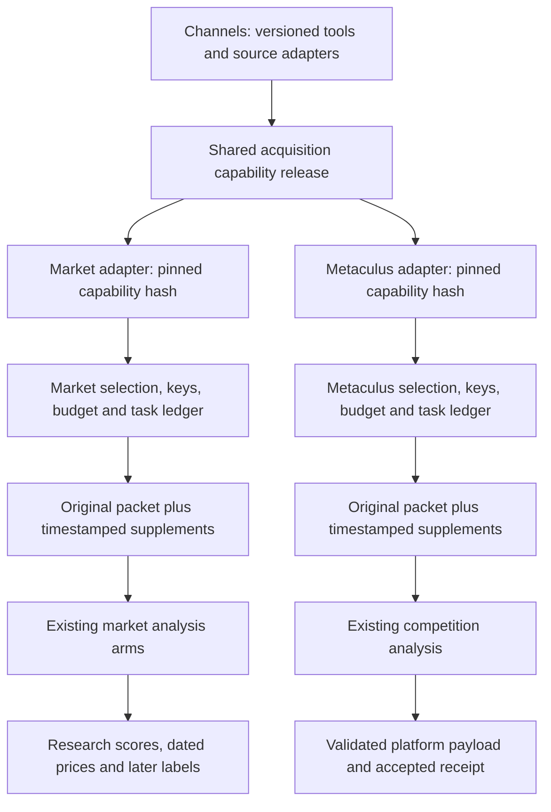

# Shared acquisition capabilities, independent forecasting deployments

This is the integration design for the validated market P0 capabilities. It does
not claim that the Metaculus production release already consumes them. Production
status requires exact deployed hashes and worker receipts.

## What is shared

The reusable capability release contains hash-verified original readers, public
worksheet navigation, bounded CSV and rendered-cell projections, short-notice
preservation, shell/action classification, source identity contracts and explicit
coverage/failure receipts. Official API adapters are supplied by the Channels
lane. Navigation produces candidate references, not certified relevant evidence.

The current P0 implementation resides in `market_repricing/acquisition_contract.py`.
It still imports the pinned engine's source parser and is **not yet a standalone
shared package**. Its generic functions can move into a Channels-owned common
module only through a reviewed source-hash handoff. Market-host exclusion,
forecast-market signals and venue-specific source roles remain in the market
adapter; Metaculus must not inherit those platform rules by copying a worker.

## What remains independent

| Boundary | Metaculus | Prediction markets |
| --- | --- | --- |
| Input identity | Post/question ID, type, options or scale, full rules | Venue, event family, contract and frozen YES identity, full rules |
| Admission | Open, eligible competition tasks | Creation-age, resolution window, event-family and rolling admission policy |
| Tavily routing | Existing primary/backup1/2 | Existing primary/backup3/4 |
| Analysis | Selected immutable competition release | Selected immutable market engine and arms |
| Delivery | Platform format validation, deduplication and receipt | Research output only; no trade or Metaculus submission |
| Lifecycle | Existing competition queue and submission ledger | Existing market queue, three executions and price-label clocks |

OpenRouter2 is also a competition fallback, so provider-account allowance is
not necessarily isolated even when task ledgers are. Provider reservations,
per-task limits, daily caps and unknown usage must remain cumulative. A shared
reader does not grant a fresh allowance or retry a terminal task.

## Acquisition contract

Each adapter retains the native original bundle and ledger. A derivative view
must identify the requested/final URL, original byte hash, capture clock, reader
version/hash, row/cell coordinates, body role and explicit omissions. It must
distinguish readable text, a complete captured response, displayed grid extent,
and verified target-series coverage. New captures become later supplements.

The common capability layer accepts a host transport and host reservation
callback. It cannot instantiate its own provider ledger or issue a hidden
request. Adapter-supplied identity and time policy remain authoritative.

Sharing code does not automatically share live evidence caches. Cross-platform
reuse requires exact source identity, matching permission/public scope and an
original capture time allowed by the consuming task. A later capture cannot
stand in for an earlier information window. Initially keep caches independent.

## Synchronization and promotion sequence

1. Freeze the common capability source commit and a manifest of code hashes,
   contract version, dependency pins and generic fixtures. Channels owns reader
   changes; Pipeline owns host adapters, workflow wiring and release gates.
2. Apply one reviewed capability release to each adapter. Use one implementation
   rather than maintaining two copied parsers. Fingerprint the capability hash
   in each newly started task. Old tasks retain their exact implementation.
3. Replay the same originals through both adapters. Include short official
   notices, shells, same-document aliases, CSV401, full and partial sheet grids,
   signed URLs, merges, truncation and interrupted reservations.
4. Run both adapters on Linux without provider credentials. Restore actual
   checkpoints and verify every original file, task, budget and accepted receipt.
   Incompatible pending tasks block promotion; never rewrite their fingerprints.
5. Perform separately bounded prospective shadow captures with the selected
   analysis models and prompts fixed. Record useful originals, duplicates,
   coverage, critical gaps, actual HTTP attempts, tokens and latency.
6. Promote each immutable platform selector only after its own gates pass. A
   market upgrade does not change a competition tag. Roll back a selector only
   when pending-task compatibility is verified; never relabel old artifacts.

For this release, the market pilot and public-table supplement provide capture
validation. The Metaculus ADIZ snapshot is a regression fixture, not a new
Metaculus end-to-end production test. Competition adoption still needs its own
adapter, Linux restore and submission-format/duplicate-delivery checks.

## Current implementation and remaining work

| Capability | Market P0 | Metaculus production |
| --- | --- | --- |
| Explicit roles and table coverage | Implemented and locally verified | Existing native reader; P0 adapter not promoted |
| Observed public tabs and cell coordinates | Implemented; two actual public captures | Saved ADIZ input replay only |
| MND document identity reuse | Implemented and replayed | Duplicate capitalized URLs observed; adoption pending |
| Authentication stop rules | Implemented;401 preserved | Common contract adoption pending |
| Independent snapshots and budget preservation | Existing runtime plus P0 checks | Existing release contract retained |

Do not compare eventual accuracy before resolution. More bodies, fewer gaps or
a successful worker are separate acquisition/operational measurements.
