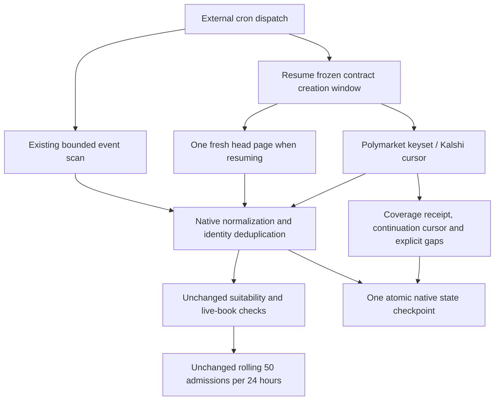

# Creation-window discovery v1

This changes discovery only. Collection, Super/Mercury prompts, scoring, provider
budgets, task execution limits and the external cron trigger remain unchanged.

## Paths and coverage

- **Polymarket:** `/markets/keyset`, `order=createdAt`, descending, 100 contracts
  per page, `include_tag=true`, `closed=false`, fixed `end_date_min`. The endpoint
  includes parent events, so a new contract under an old event keeps its family.
  Creation bounds are applied locally; no undocumented creation query is sent.
  The scan ends at cursor exhaustion or the verified descending creation boundary.
- **Kalshi:** `/markets`, `mve_filter=exclude`, 1000 contracts per page, fixed
  `min_created_ts` and `max_created_ts`, opaque cursor. Both boundary seconds
  overlap; local exact timestamps enforce the frozen window. No unsupported
  combination of creation and close-time server filters is used.
- Native local screening still requires creation age at most two hours, a
  sufficiently long trade/resolution window and suitable event content. Missing
  rules, low relevance, crypto and gambling are not admitted to fill a quota.

The original event scan stays at five pages per venue. The authoritative cursor
path receives four pages per venue per dispatch, including its optional head.
With the production configuration discovery uses at most20public requests. The
120-request transport cap leaves100for the existing40metadata,40book and20final
resolution allowances. There are no implicit HTTP retries or model/search calls.

## Durable state and failure behavior

`state.json.discovery_windows[venue]` contains a versioned active window, opaque
cursor, seen contract IDs, cursor hashes, completed-window watermark and bounded
diagnostic history. It is saved atomically with ingested rows in the same native
ledger. A hard process kill before publication can replay a page; it cannot save
a cursor that acknowledges rows absent from that checkpoint. Raw public-response
receipts retain their actual observation times.

The next completed window overlaps the preceding watermark by20minutes. A resumed
window reserves one fresh head request when its page budget permits, so newly
created contracts can be considered before old pagination finishes. That head
never advances coverage. Completing an old window opens its newer continuation;
`complete` remains false until the current frozen scan clock is covered.

Failed HTTP, malformed payloads, missing clocks, invalid ordering and repeating
cursors leave the failing page unacknowledged. Errors remain visible. An expired
unfinished window or an outage beyond the two-hour admission interval creates an
explicit historical gap. Older questions are not retrospectively admitted.

`report.json.discovery_coverage[venue]` gives scope, window bounds, coverage lag,
pending window/cursor, errors, completed windows and historical gap count. Recent
diagnostic history is capped at24entries; older gap counts remain cumulative and
published immutable checkpoints retain earlier details. These are API-query
coverage statements, **not platform-wide no-missing-question guarantees**. Search
index delay, provider outages and bounded discovery can still create gaps.

## Verification

Run `python -m unittest ForecastAgent.market_repricing.tests.test_discovery`.
The saved-state gate also restores a real production monitor checkpoint and
checks this protocol without network, enrollment, provider reservations, task
reopening or modifications to any restored original file.

Reference contracts: [Polymarket keyset API](https://docs.polymarket.com/api-reference/markets/list-markets-keyset-pagination)
and [Kalshi markets API](https://docs.kalshi.com/api-reference/market/get-markets).
