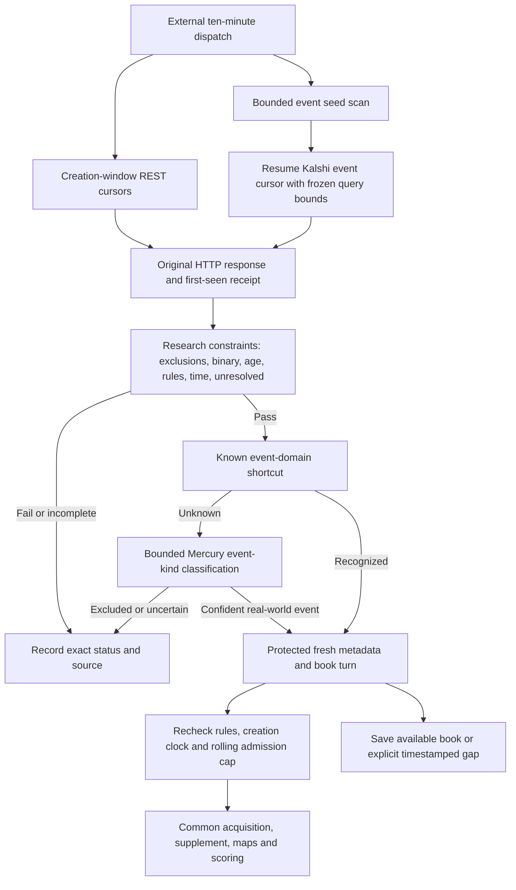

# Prediction-market intake

`market-v0.3.11-observation.1` separates research eligibility from book quality.
The earlier `market-v0.3.10-intake.1` introduced admission discovery. The immutable common
acquisition engine, search limits, supplement, maps and scoring prompts are
unchanged. Competition uses the same acquisition core but keeps its own official
question discovery, typed contracts and delivery release.

## Flow



Discovery success, first sighting, eligibility, admission and completed scoring
are separate states. A first sighting is not evidence of platform-wide coverage.
Only native `enrolled_at` receipts consume the existing rolling cap of 50 families
per 24 hours; neither midnight nor a policy change renews it. Current creation
age remains at most two hours and minimum expected resolution/close windows
remain seven days. Early resolution remains possible under platform rules.

## Book quality is observational

Spread, top-of-book size, liquidity, volume, missing prices and temporary
orderability are not research admission gates. Sports and gambling exclusions
remain content rules. Real business/economic measurements are eligible event
outcomes; an action by a named actor is not required for a statistical release.
There is no blanket crypto-industry or asset-price exclusion. Unknown propositions
still receive bounded suitability review; a sector alone does not prove gambling.
The existing binary, exact-rules, creation-age, horizon, rolling-cap and
already-closed/resolved restrictions remain in force.

Each new task records `admission_quote`: the exact prior observation, whether it
belongs to this dispatch, and an explicit `not_observed` or `stale` state when
needed. A stale price is never relabeled as the admission-time price. Available
metadata/book turns still run; missing or poor books do not defer enrollment.
Family representatives no longer receive priority based on volume/liquidity.

Before scoring, `anchor.json` freezes an analysis context clock. Its
`received_at_role=analysis_context_frozen_at` is distinct from the original
`quote_observed_at`; the verbatim observation is retained in `original_quote`.
Valid two-sided shallow/wide books retain their status/flags and can supply a
noisy observed midpoint. One-sided, failed, stale and crossed books supply null,
never an invented 0.5, zero or old price. A book identity/schema failure is
retained as an explicit `invalid_book` error and never supplies a price. Contract
metadata identity/schema failures remain separate blocking errors; an invalid
book alone does not reject research on an independently verified contract.

The unchanged Mercury scoring inputs can carry that null price with the same
original evidence. Event forecasts remain eligible for later resolution-based
evaluation. With no initial midpoint, future price errors are recorded separately
under `unpaired_arms`; no-change and direction comparisons are unavailable. A
missing book never grants trading permission. Existing terminal cases and sealed
forecast identities are preserved; incompatible pending versions block promotion.
The exact `3ccf35e` predecessor is resume-compatible because capture/scoring
stages, prompts and quotas remain identical. Its immutable positive suitability
approvals remain valid only under their original input hash, known policy hash
and confidence threshold; negative/uncertain decisions do not inherit approval.
The original request receipts and cumulative budgets are retained. This permits
queued continuations to use the new orchestration without restarting an active
worker or requiring a second suitability request for an unchanged approved event.

## Bounded semantic classification

Known lexical event domains do not need a model request. Unknown candidates are
reviewed only after hard checks. Mercury uses the Decisions endpoint, with one
explicitly identified question per candidate, not chat completion or a forecast
probability. Full supplied rules are retained; oversized inputs are deferred,
never silently truncated. Public rule text is treated as untrusted data.

| Limit | Value |
| --- | --- |
| HTTP reservations per monitor dispatch | 1 |
| Candidate event families per request | 8 |
| Intake requests per UTC day | 40 |
| Lifetime attempts per unchanged candidate input | 2 across prompt versions |
| Failed/interrupted request retry delay | 30 minutes |
| Accepted event score and confidence | Both at least 0.8 |
| Credential | `OPENROUTER2`, no implicit switch to competition keys |

This is an **additional, separately audited intake allowance**, not a reset or
increase of any native collection/search/task allowance. Requests are charged
before HTTP, including interrupted reservations. Provider account limits still
apply. Service errors, missing configuration, uncertain answers and exhausted
limits leave candidates pending and visible. Accepted and negative answers are
cached by input and prompt-policy fingerprints. A changed prompt invalidates
decisions but does not renew lifetime attempts. Entity/rule changes invalidate
approval; hard exclusions and clocks are checked again at every use.

The native worker receives the exact bound review at its later rule/price-anchor
refresh. A detail endpoint omitting parent-event metadata does not create a new
event family. Wrong market identity fails closed. No forecast, trading action
or Metaculus submission is performed by intake classification.

## Records and health

- Native monitor state stores the current three-hour first-seen index, lifetime
  first-seen count since installation, current selection and bound review.
- `intake/sightings/<hash>.json` preserves timestamped first-seen and changed
  metadata receipts, including hard-excluded rows. Original response bodies stay
  in the existing HTTP object archive. Older hot-index entries can expire without
  deleting these original receipts.
- `intake/review-state.json` retains all request reservations, retry history and
  result bindings. `intake/requests/<number>.json` holds requests, responses,
  provider identity and reported usage. Missing/corrupt journals never reset usage.
- Monitor `report.json` adds first-seen counts, actual review attempts, separate
  pending statuses, new admissions and explicit warnings. A declared creation
  coverage lag over twenty minutes, or an otherwise eligible intake stalled for
  twenty minutes, is visible independently of ordinary old-price refresh success.
- Up to four of the existing forty book/metadata slots protect fresh candidates
  during a flood of due old labels. Old labels retain the other slots. Public
  request ceilings and native provider quotas are unchanged.

The complete Kalshi creation cursor remains the coverage authority. Its separate
event seed now resumes a frozen close-filtered query rather than repeating the
first five pages. Event-seed completeness never certifies the whole platform.
Kalshi creation-time and close-time filter families cannot be combined in a
single market query; they remain separate discovery paths.

## Source references and limitations

Mechanisms were inspected at fixed commits. No third-party service was installed
or executed, and no unlicensed source was copied.

- [Marfusios lifecycle handler](https://github.com/Marfusios/kalshi-client-websocket/blob/0a2b19472d3b7f014a67c09f801b9327dee67c92/src/Kalshi.Client.Websocket/Client/KalshiMessageHandler.cs): separate lifecycle notifications from book updates.
- [bububa reconnect/subscriptions](https://github.com/bububa/polymarket-client/blob/7294bd40707eb5c4cf98eb2b8812bec5ed4e4398/clob/ws/client.go): subscription replay and explicit new-market handling.
- [bainluck polling](https://github.com/alexander-bain/bainluck/blob/c086f4f660e069958e2f6d7258140e13c729a163/backend/app/tasks/polymarket.py): bounded, resumable work and discovery health separate from refresh success. Its offset/start-date approach is not substituted for our creation-keyset scan.
- [jamtho discovery](https://github.com/jamtho/polymarket-fetcher/blob/48fd8362166f2d447a9c1fed98f2cc4c825ab32c/src/pm_fetcher/pollers/market_discovery.py): original observations before identifier differences. This unlicensed implementation was used only as a design reference.
- [Kalshi market filters](https://docs.kalshi.com/api-reference/market/get-markets).

WebSocket listeners are not installed in this finite Actions job. Kalshi needs
authenticated lifecycle access, and Polymarket asset-scoped subscriptions are
not an independently verified global listing census. REST cursor reconciliation
is retained. No code change can reconstruct a missed historical information
cutoff. Prospective recall and forecast quality need subsequent live observations;
cached suitability decisions and unit tests are not accuracy measurements.

## Validation

```text
python -m unittest discover -s ForecastAgent/market_repricing/tests -v
```

Gates cover unknown operational events, short/distant horizons, exclusion and
uncertainty, per-question binding, rule drift, detail omissions, restart/cache
reuse, durable caps, protected new-book turns, event cursor continuation and a
synthetic discovery-to-admission loop. The Linux preservation workflows restore
real monitor/worker/competition checkpoints and verify original files, tasks,
submission receipts and provider reservations without provider calls.
