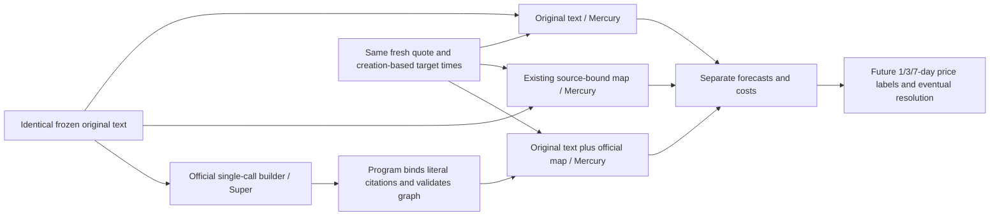

# Official Metaculus map research sidecar

This is a local experimental third arm. Production acquisition, model routing,
admission, submission and trading remain outside this module.

## Pinned reference

Repository: <https://github.com/Metaculus/map-forecasting-research>

Commit: `c34f34666207bcaa2aaee489a780bc835c41fb36` (2026-09-28).
The BSD-2-Clause Python sources and complete license are retained unmodified in
`_official_map`, with a manifest of normalized source hashes.

We use the upstream `build_map`, `MapIR`, structured-output interface and
probability coherence projection. We do not use its OpenAI SDK client, remote
Radiant services, automatic map expansion or reference-map LLM grading.

## Three-arm experiment



The graph model sees only the decision control's exact original spans, question
and rules. It sees neither earlier forecasts nor any future outcome labels.
The official builder proposes sparse factors and direct edges toward one goal.
Our documented LLM adapter adds citations to its structured-output contract.

The first live three-case pilot exposed model-generated quotation errors and a
source ID mistaken for a span ID. Its rejected strict maps remain archived.
The reference-only v2 adapter asks the model for existing span or source handles
and lets the program bind their exact visible coordinate ranges. It does not
present a node description as an original quotation or verified observation.
Source handles bind only the already delivered spans, never hidden page text.
Every node and arrow remains an unverified hypothesis; necessary/sufficient
labels do not enforce logical probability constraints. This is a separate
hypothesis arm, not a relaxation that certifies the failed strict maps.

The follow-up preserves the same three controls and quotes and shares the
original fifteen-request cap. The first two cases may use their one remaining
map slot. The third uses an offline reference-only projection of its saved
complete response, with generated quotations quarantined. No fresh map request
is granted to that case, which already consumed two map slots.

The goal is bound by the program to immutable `state.question`. A model display
caption stays separate and cannot redefine the proposition. Source references
are context pointers, not certificates that a model claim is true. This avoids
requiring the model to reproduce the target title character for character.

## First pilot receipt

All three cases have original, existing-map and official-reference-map scores.
Actual new model HTTP requests: **15 total**, including six Super map attempts
and nine Mercury decision requests. There were six fresh public metadata/book
GETs and no search or source-fetch calls. The earlier strict rejection records
remain intact. Two quotes were shallow and are observational samples; one case
is depth-qualified. All eventual outcomes and future target labels are pending.
The three cases are an exploratory integration sample, not a held-out skill
benchmark. The reference-only adaptation was developed after inspecting these
failures and must be checked on fresh cases before any promotion.

The program binds each citation to the exact visible evidence ID, literal quote,
source hash and coordinate range. It rejects missing citations, unknown or
silently dropped edges, cycles, outgoing goal arrows, and necessary/sufficient
edges without a literal rule binding. The delivered graph must retain a complete
grounded path to the goal and fit the existing 5,600-byte map budget. It may not
introduce additional original text into one decision arm.

These are literal and structural checks. They do not prove a factor's meaning,
causal direction or relevance. All descriptions and arrows remain hypotheses.
Edge membership confidence is never multiplied into event probability.

## Boundaries and costs

- Super: normally one map call; at most one formal repair, two physical requests.
- Mercury: one actual decision-endpoint call per arm, at most three per case.
- Initial pilot: three existing unresolved event families, at most 15 new model
  HTTP requests and six public metadata/order-book GETs.
- No source searches, source crawling, production task reopening or quota reset.
- Existing task/provider reservations are retained. Failed graph construction is
  a missing experimental arm, never a synthetic copy of a successful control.
- All three arms share original coverage, decision heads, quote, material cutoff
  and target clock. Later forecasts are new vintages; old scores stay intact.

An event occurrence forecast is distinct from a future market-price forecast.
Price heads predict the future YES bid/ask midpoint conditional on the contract
remaining open. Shallow-book anchors remain observational and are excluded from
depth-qualified model metrics. Late forecasts and missing quote windows stay
ineligible. Unresolved cases have no observed Brier or price-error metrics yet.

## What the upstream code does not establish

`build_map` is a causal sketch builder. It does not estimate conditional
probability tables, learn a Bayesian network or provide a proven market alpha
model. Its map `score_map` compares against a reference map; that score is not an
event probability or a forecasting-performance score.

The quantitative builder supplies field methods and formulas, but its validator
alone does not establish acyclicity, formula safety, unit correctness, evidence
accuracy or a probability evaluator. It is not enabled in this first sidecar.

`coherence_diagnostics` exposes the pinned upstream probability projection for
explicitly defined logical question sets. It is diagnostic only and never
replaces a forecast automatically. Logical coherence is not empirical
calibration. The first three-arm pilot does not add conditional-probability
decision heads, so it does not claim to test conditional-probability forecasting.

## Run

```text
python -m pip install -r ForecastAgent/market_repricing/requirements-official-map.txt
python -m unittest ForecastAgent.market_repricing.tests.test_official_map -v
python -m ForecastAgent.market_repricing.official_map_trial --root /path/to/frozen-trial
python -m ForecastAgent.market_repricing.official_map_metrics --root /path/to/local-data
```

The trial requires an immutable manifest with matched saved states, registry,
market identity, original provider records and a bounded model allowance. All
results, rejected proposals, raw model responses, usage, timestamps and hashes
are retained. The manifest is independent of live production admission.
The generic trial entry point now uses the reference-only adapter directly;
the initial strict quotation path remains available for diagnostic replay.
Adapter hashes are frozen in the trial identity, so old completed attempts
cannot silently restart under changed code or renew any allowance.
