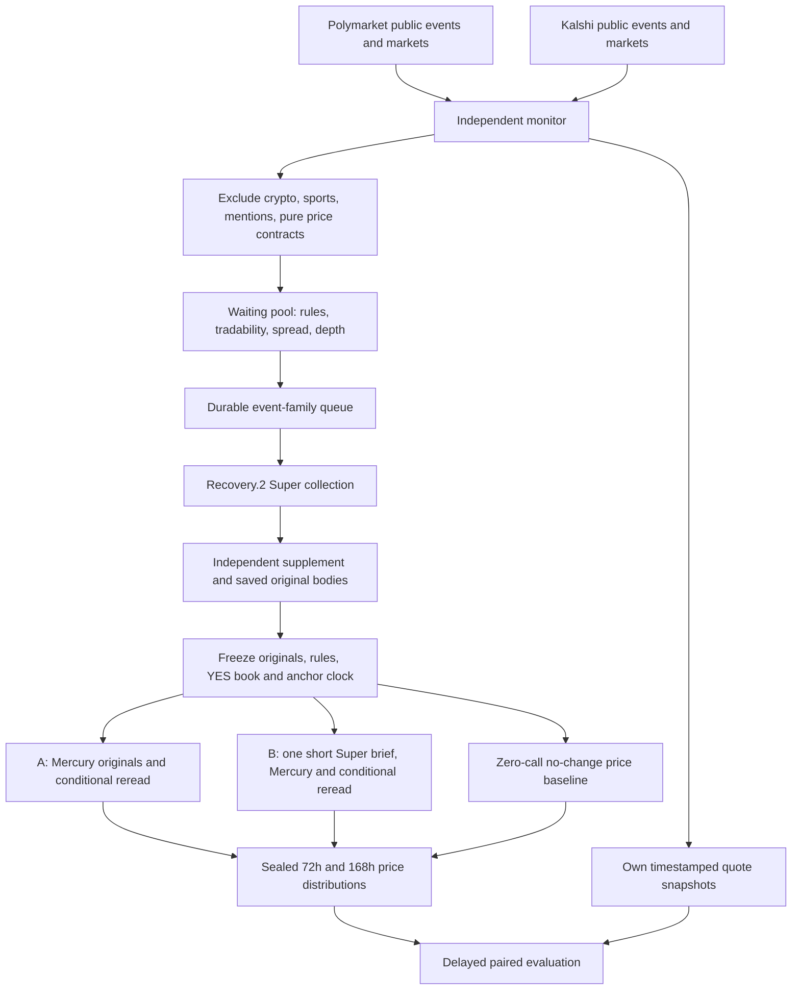

# Market repricing research v1

This is an independent, read-only sidecar. It does not import the competition
delivery path, submit forecasts, place orders, or require a trading credential.

## Frozen runtime

| Layer | Version |
| --- | --- |
| Collection, independent supplement, Crawl4AI | `v1.0.5-recovery.2` |
| Exact collection source commit | `bf9a425f8425c9a685bd3b24979935b7cfe04981` |
| Core original-evidence Mercury analysis | Release 1.0.1 |
| Original context delivery selectors | Release 1.0.4, shipped in Recovery.2 |
| Collection model | `nvidia/nemotron-3-super-120b-a12b:free` |
| Decision model and endpoint | `inception/mercury-decide:free`, `/api/alpha/decisions` |
| New research target | `price-grid-v1`, additive adapter, separate from event probability |

The infrastructure branch is `codex/market-repricing`. Infrastructure `main`
does not contain the full frozen runtime. The worker checks out the exact release
commit separately. `runtime.activate` verifies the commit and release manifest,
then loads every existing dependency from that release. Only this new sidecar
package is additive. The unfinished research-map branch is not the runtime.

The original collector requires a numeric question ID. A deterministic internal
compatibility ID is recorded along with a namespaced venue ID and
`synthetic_compatibility_id=true`. It is never a Metaculus submission ID.

## Flow



## What the labels mean

Event probability and future market price are distinct. Each Mercury request has
an eventual-event diagnostic head and **two separate predictive choice heads**.
The price heads distribute mass over 21 representative prices from 0 to 1 in
0.05 increments. Their expectation is the forecast midpoint. This finite grid
is an approximation; it is not a set of independent binary event probabilities.
Event probabilities retain the release's 0.02–0.98 clip. Price means are not
silently clipped to that event-probability range.

The target is the observed YES midpoint conditional on continuing tradability.
Both arms start with identical original spans. A diagnostic reread can add
different spans per arm. Audits preserve those differences; this is a paired
pipeline comparison, not a claim that model inputs remained identical after
rereading. A brief contains source references, not certified facts.

The anchor is taken **after collection and supplement**, so the collection
latency does not contaminate a forecast supposedly made before its evidence.
Seal latency must be at most 30 minutes. Outcomes and later quotes are not
included in inference. The label uses the latest usable captured quote in the
30-minute window ending at `anchor+72h` or `anchor+168h`. Later quotes never
substitute for a missed window. Early resolution, changed rules, missing data
and late forecasts remain explicit in the denominator/attrition report.

The no-change baseline forecasts the anchor midpoint at both horizons.
MAE and RMSE compare both arms and the baseline on the same available paired
questions. Questions are grouped by venue event family; cross-venue title
similarity does not establish rule equivalence. Market repricing is a research
target, not a substitute for eventual-event Brier, and not proof of trading alpha.

## Discovery and selection

The bounded newest-market feed is heavily dominated by crypto and sports.
The primary feed therefore uses event-level discovery and a minimum platform
close horizon. Polymarket exclusion tags are resolved by slug, not hardcoded
IDs. Kalshi uses nested events with `min_close_ts`. A bounded newest-market
overlap also observes newly created children of older events.

Creation date, first seen, first observed tradability, metadata hash versions,
rules digest and public receipts are retained. A close date is an explicit
platform hint, not an inferred authoritative event deadline. A domain match
records `plausible_unconfirmed`; it never creates a fictitious confirmed
catalyst or date. Unknown relevance remains in a waiting pool.

The first pilot admits at most 30 venue event families total, at most 5 per UTC
day, and at most 5 per worker dispatch. There is no automatic budget renewal
or endless replenishment of terminal tasks. Excluded crypto includes companies,
ETFs, regulation and related products. Sports, esports, social counts and pure
price wagers are also excluded. A shortfall is acceptable.

Quote gates: both sides, no crossed book, spread <= 0.08, top size >= 20 on
each side. Polymarket selects the actual YES token even when outcomes are
reversed. Kalshi fixed-point books provide YES bids and NO bids: YES ask is
`1-max(NO bids)`, with the corresponding NO quantity. Integer-cent schemas are
not guessed. Authentication failures remain captured gaps. Displayed market
prices and last trades do not substitute for these book snapshots.

## Actions, budgets and recovery

- `market_research_monitor.yaml`: public data only, no provider/model secrets.
- `market_research_worker.yaml`: separate checkpoint, original collector and
  supplement, original-evidence decisions, no delivery method.
- `market_repricing_tests.yaml`: offline gates and actual frozen selector integration.

Automatic jobs are gated by repository variable `MARKET_REPRICING_ENABLED=true`.
The monitor schedule is 15 minutes, offset from the top of the hour. GitHub can
delay scheduled jobs; missed windows are explicit. An external cron can instead
dispatch the monitor, with the built-in schedule removed for a single-source
test. Do not configure both until deduplication and timing have been observed.

```text
POST https://api.github.com/repos/chenencc/futureeval-forecasting-agent/actions/workflows/market_research_monitor.yaml/dispatches
Authorization: Bearer YOUR_GITHUB_TOKEN
Content-Type: application/json
{"ref":"main"}
```

The worker consumes the exact monitor run and restores its latest completed
checkpoint, including failed runs. A missing checkpoint after an attempted
mutation fails closed. Source repository, workflow, branch, archive members and
file hashes are checked. Separate role artifacts prevent a monitor and a
worker from overwriting each other's ledger. Completed/terminal tasks do not
recollect. Retries wait at least an hour and preserve all release journals;
three executions maximum. A valid first Mercury result survives reread failure.

Research uses **OPENROUTER2 only**; it cannot consume production's primary router
key by fallback. Search credentials are `TAVILY_KEY1/TAVILY_KEY2` and
`EXA_API/EXA_API2`. The release's physical search reservations remain unchanged:
at most three initial Tavily basic searches and one Exa search per task. Extract
and supplement operations have their own frozen release limits. Outer sidecar
physical limits add 200 model requests and 20 search requests per dispatch,
400 model requests per UTC day and 60 model requests per task. Errors and
unknown outcomes consume reservations. Switching backend or restarting cannot
erase them. On Linux, each research task also has a 20-minute outer deadline.

Artifacts retain raw compressed content-addressed public responses, HTTP
reservations, metadata/rules versions, original collection and supplement,
source hashes and excerpts, analysis requests/responses, anchors, labels and
gap/status records. Existing `ForecastAgent.local_sync` discovers completed
Actions artifacts and can import them into `E:\metaculus_data`; the new artifact
names do not require a new local schema workaround. Sync must actually run
before claiming local archival. Ninety-day artifact retention and a finite
30-family pilot are not an unlimited durable cloud database.

## Verification

```text
python -m unittest discover -s ForecastAgent/market_repricing/tests -v
MARKET_RELEASE_DIRECTORY=/path/to/recovery2 python -m ForecastAgent.market_repricing.tests.verify_frozen_runtime -v
python -m ForecastAgent.market_repricing monitor --root snapshots/market-monitor
python -m ForecastAgent.market_repricing.runtime --release .release --root snapshots/market-worker --monitor snapshots/market-monitor --verification-only
python -m ForecastAgent.market_repricing evaluate --root snapshots/market-monitor --worker snapshots/market-worker --output snapshots/market-worker/evaluation.json
```

Offline fixtures do not prove live crawler, model or Actions operation. Release
manifest verification proves source identity, not forecasting skill. Public
probe reports must be inspected before enabling the model worker. Wait for
actual horizon labels before reporting predictive metrics.

Primary API references:
[Polymarket events](https://docs.polymarket.com/api-reference/events/list-events),
[Kalshi events](https://docs.kalshi.com/api-reference/events/get-events),
[Kalshi public market data](https://docs.kalshi.com/getting_started/quick_start_market_data).
