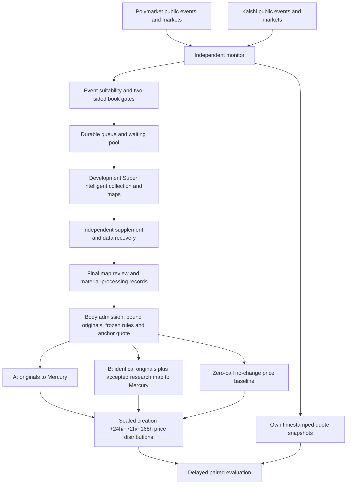

# Market repricing development pilot v2

An independent, read-only Polymarket/Kalshi research sidecar. It has no trading
or Metaculus delivery entry point. Production competition workflows stay separate.

## Selected engine: latest development, not Release

| Layer | Implementation |
| --- | --- |
| Engine branch | `codex/official-intelligence-v106` |
| Exact development snapshot | `c17c1ec4ee3e2458108031a324b45853aa9e7502` |
| Collection entry | `intelligence.pipeline.collect` |
| Capabilities | Native channels, Super acquisition/map fusion, predictive focus, reference binding, scoring delivery |
| Recovery | Independent supplement, data-resource recovery, final-map material processing |
| Analysis inputs | `intelligence.admission.prepare` and `research_loop.prospective_trial.prepared_pair` |
| Analysis transport | Development `research_loop.decision_http` |
| Collection model | `nvidia/nemotron-3-super-120b-a12b:free` |
| Decision model | `inception/mercury-decide:free`, `/api/alpha/decisions` |
| New target adapter | `development-map-price-grid-v3` |

The sidecar branch is `codex/market-repricing`. Actions checks out the exact
development snapshot into `.development`. `runtime.activate` verifies the commit,
tracked-tree cleanliness and implementation identity, then loads every existing
dependency from that development tree. It does not check out or fall back to a
Release tag. Historical shared helpers in the development tree retain their
audited budgets; this reuse does not make the development candidate a Release.
Update the explicit pin and identity for each new experimental engine.

Numeric collector IDs are internal compatibility IDs, paired with namespaced
venue IDs and marked `synthetic_compatibility_id=true`, never submission IDs.

## Flow



Maps are built during acquisition and final material processing. There is no
additional independent brief request after collection. Both scoring arms share
identical admitted original text and the same event/future-price heads; the map
is the added field in B. Development projection binds quotes, reference IDs,
source scope and unknown predicates. Unsupported or oversized maps become an
explicit original-only fallback, never a fabricated map. Such cases are not
successful map-vs-original comparisons.
When no accepted map is deliverable, B is `not_comparable` and consumes no
additional scoring request. The available A forecast is retained; map-contrast
metrics exclude these cases and report the missing-map count explicitly.

Each arm has one lifetime Mercury request. Failed journals remain saved. The
new price adapter does not silently route through Release or invent a price.
Missing-arm attrition and original-only availability are explicit.

## Targets and freeze

Event probability and future market price are separate. Mercury receives the
development event head and predictive choice heads for creation +24, +72 and +168 hours. Each
price head distributes mass over 21 representative prices from 0 to 1 in 0.05
steps. Its expectation is the price forecast, not an independent event probability.
This grid is an approximation. Event probabilities retain the 0.02–0.98 clip;
price means do not silently inherit that event-probability clip.

The development map describes world events and evidence. The additional price
heads reason about information traders may absorb during each horizon. Map
conditions are not automatically market-price distributions or verified causes.

The anchor is observed after collection and final material processing. Inference
cannot use later evidence. Seal latency is capped at 30 minutes. A label uses the
latest usable quote in the 30-minute window ending at `market.created_at+24h`, `+72h` or `+168h`. Later quotes cannot fill a missed window. Early resolution, rule
changes, missing windows, failed arms and late forecasts remain explicit.
No-change predicts the anchor midpoint at each eligible horizon. Already elapsed targets are omitted from model requests; forecasts sealed after a target cannot be evaluated against that target. Paired MAE/RMSE compare
all arms on the same available cases. Eventual Brier and trading PnL are separate;
no predictive skill is claimed before delayed labels exist.

## Selection

Event discovery avoids saturation by crypto and sports launches. Polymarket
exclusion tags are resolved by slug. Kalshi uses nested events with a minimum
close time. A bounded newest-market overlap observes new children of old events.
Page caps retain `complete=false`, not a claim of complete venue coverage.
Creation date, first seen/tradability, metadata/rules versions and raw receipts
are saved. A domain match is `plausible_unconfirmed`, not an invented confirmed
catalyst date. Platform close hints are not authoritative event deadlines.
Unknown relevance, missing rules and liquidity remain in waiting pools.

New test questions must have a platform creation timestamp within the rolling
last two hours at enrollment. Updated timestamps and first-seen time cannot make
an old question new. Expected resolution must be at least 168 hours away and
platform trading close must also leave 168 hours. Kalshi expected expiration is
recorded separately from order close. Polymarket requires an explicit dated rule
deadline agreeing with the metadata date; it is a deadline estimate, not a
guarantee against early settlement. A rule-delegated title date can also qualify
when title month/day, explicit 11:59 PM ET rule time and platform timestamp agree
in America/New_York. The platform supplies the matched year; DST and year rollover
are checked. A mismatch or missing explicit delegation remains unknown.
Unknown resolution time waits for rules.
The 7-day condition is checked again at the price anchor; creation eligibility
remains frozen at enrollment, so an hour-long retry does not relabel the question.

Platform close hints must be 7–90 days away. Exclude crypto (including
companies, ETFs and regulation), sports/esports, social counts and pure price
wagers. Composite contracts/title conjunctions are conservatively excluded from
the first single-event pilot. Rejections and shortfalls are retained.

Books require two sides and top size >= 20 on both sides. Wide spreads no longer
block admission, forecast anchoring or delayed quote labels. The 0.08 threshold
is retained only to add `quality_flags=["wide_spread"]`; the observed midpoint
remains available for research. It is not an executable fill price or a reliable
market consensus estimate. The scoring inputs and delayed labels retain this
quality flag alongside both prices and sizes. Crossed books remain invalid.
Polymarket uses the actual YES asset, including reversed outcome arrays. Kalshi
fixed-point YES ask is `1-max(NO bid)` with the corresponding size. Ambiguous
cent schemas are not guessed. Display prices/last trades are not book snapshots.

At most 30 new venue event families enter per rolling 24 hours, counted
from immutable enrollment timestamps. Failed tasks consume the same window slot;
retries do not count as new tasks. The initial three-family lifetime cap is removed.
Workers retain batches of at most three tasks per dispatch and their existing
provider budgets. Thirty admissions do not guarantee 30 completed analyses that
day when provider budgets or service availability limit throughput.
Each family gets a quote turn before additional thresholds.
Cross-venue title similarity does not establish rule equivalence.

Admission freezes the then-current quote inside the immutable queued market.
Only a usable quote received during that monitor dispatch can admit a new task;
an older successful book is not reused as a current price.
The worker also writes `tasks/<hash>/entry-quote.json` before model work and
preserves a separate post-acquisition `anchor.json`. Both include observation time,
YES best bid/ask, size, spread, midpoint, ten visible levels per side, and original
book provenance. The original full Polymarket response and returned Kalshi depth
are retained in compressed HTTP objects; Kalshi collection requests ten levels.
Admission and forecast anchors must not be conflated.
Due creation +24h/+72h/+168h label windows have priority over routine quote turns. Remaining
quote capacity is shared between new candidates and active cohorts; active
cohorts rotate by oldest observation. Labels are evaluated for every frozen
forecast even after its active quote window ends. Missed quotes remain explicit.

## Creation-based follow-ups and final results

All existing and new enrolled contracts receive a separate `followups/<hash>.json`
and the small `tracking.json` local-sync projection. The origin is the immutable
platform market `createdAt` (Polymarket) or `created_time` (Kalshi), not local
`state.created_at`, first seen, enrollment, or forecast completion. Those fields
are creation proxies; neither venue provides a universally verified publication
instant in this contract. New enrollment rechecks the two-hour boundary after
search and quote requests complete.

Each record freezes target UTC timestamps at creation +24, +72, and +168 hours.
The latest usable YES bid/ask midpoint in the preceding 30 minutes is retained
with actual receipt time, spread, depth, raw-response hash and quality flags.
No later price substitutes for an absent observation. This collection continues
regardless of whether model analysis completed, failed, or produced only a
baseline. It makes no new model or search calls.

Historical sealed forecasts retain their anchor +72/+168 targets in `labels/`.
They are never relabeled as creation-based predictions. New tasks freeze a
creation-based `price_schedule` at admission and use it in Mercury instructions,
results and evaluation. Evaluation separates cohorts by origin; scores sealed
at or after a target are excluded. Old pending tasks retain their old heads.

Metadata/final-result checks continue after day seven. Unresolved tasks become
due every six hours; confirmed results are rechecked daily for corrections.
These are due intervals, serviced by the next cronjob/Actions monitor invocation
within the bounded, fair queue. Each dispatch allows 40 metadata, 40 book and
20 resolution requests, inside 120 public HTTP attempts. Urgent price windows
precede routine final checks; a capacity deferral remains explicit.

Polymarket final outcomes require a closed CLOB condition, matching YES token,
and exactly one explicit winner. Display prices of 0 or 1 are insufficient.
Closed without a winner, disputes, missing identities and fetch failures remain
pending/gaps. Kalshi requires `status=settled` and an explicit YES/NO result.
The platform settlement timestamp is retained when available; Polymarket's
first observed terminal time is explicitly not an invented resolution time.
All changed terminal observations and raw receipts are retained. Event Brier
requires a verified binary result, matching rules and a pre-result forecast;
price MAE/RMSE remain separate. Nonbinary/unknown settlement cannot become NO.

`tracking.json`, raw captures and follow-up records use the existing incremental
local sync. Repeated bodies are not downloaded again. The monitor checkpoint
keeps older tasks after they fall outside the new-admission window.

## Actions, budgets and recovery

- `market_research_monitor.yaml`: public discovery/quotes/labels, no model secrets.
- `market_research_worker.yaml`: selected development collection/maps and scoring.
- `market_repricing_tests.yaml`: independent offline and actual development gates.

Automatic jobs require `MARKET_REPRICING_ENABLED=true`. Monitor schedule: 15
minutes. GitHub can delay runs; missed windows stay missing. An external cron
can dispatch instead, with the built-in schedule removed for a single-source test.

```text
POST https://api.github.com/repos/chenencc/futureeval-forecasting-agent/actions/workflows/market_research_monitor.yaml/dispatches
Authorization: Bearer YOUR_GITHUB_TOKEN
Content-Type: application/json
{"ref":"main"}
```

Use OPENROUTER2 only, with no production router-key fallback. Search credential
names: `TAVILY_KEY3/TAVILY_KEY4`, `EXA_API/EXA_API2`. Development collection retains
initial lifetime limits of three Tavily basic searches and one Exa search per
task; capture/Extract/supplement have separate existing limits. Remaining model
decision/failure reservations are restored across retries. Outer physical limits:
200 model and 20 search requests per dispatch, 400 model requests per UTC day,
60 model requests per task. Errors/unknown attempts consume reservations. At
most three executions, at least an hour between retries; no backend budget reset.
Linux research tasks have a 45-minute outer deadline, enclosing the development
collector's own shorter limits. Empty queues and verification-only runs skip the
browser dependency installation and all model calls.

Role-specific v2 artifacts prevent mixing ledgers or resuming the Release pilot.
Restore checks workflow/repository/branch, archive members and file hashes. A
missing latest mutated checkpoint fails closed. Terminal tasks do not recollect.
V1 probes remain historical evidence, not adopted v2 acquisition/analysis results.

Worker state roots are resolved before native collection. Supplemental children
run from the pinned engine checkout, so request/output paths must be absolute.
Role artifacts include hidden files. A prior artifact that omitted native
`.lock.recovery` markers may restore only that known one-byte `0` payload when
its exact SHA-256 matches the original inventory. Original inventories/ZIPs,
provider journals and task counters remain unchanged. Every other missing file
or unknown mutex payload fails integrity checks; repairs receive a separate audit.

Artifacts preserve compressed raw responses, collector/supplement journals,
maps/material-processing records, body admission, matched scoring inputs,
provider requests/responses, anchors, labels and gaps. `ForecastAgent.local_sync`
can archive completed Actions artifacts into `E:\metaculus_data`; actual sync
must complete before claiming local archival. Ninety-day artifact retention and
a finite pilot are not an unlimited durable cloud database.

The authorized policy migration accepts only the exact deployed admission-policy hashes and identical engine/provider budgets. They record old/new identities,
retains enrolled tasks, legacy daily counts and physical reservations, and never
resets them. Any unrelated policy or engine drift still fails closed.

## New-task evidence capture v2

New monitor admissions declare `acquisition_policy=market-evidence-capture-v2`.
Existing tasks, sealed forecasts, first packages, retry counters and provider
reservations keep their original protocol. The engine remains pinned to `c17c1ec`;
this sidecar adapter does not modify the development checkout or competition
Release. Mercury price/event heads and analysis routes are unchanged.

Each successful or failed native search boundary preserves its provider record
and attempts up to four known source URLs before another model turn. These reads
use the real native fetch implementation, accepted source catalog, public-address
checks and the existing eight shared fetch reservations. No model or search
request is added. Exact rules-designated URLs rank first; safe HTTP and HTTPS
are supported, with publisher diversity for ordinary leads. Search-role and
need-ID associations are routing hints, never factual verification.

A legacy `fetch_page` model call is compatible only when the equivalent
`read_sources` capability is offered. Its exact URL still has to be in the saved
catalog. A local `inspect_research_state.limit` outside its declared bounds is
clamped with requested/effective values recorded. No network parameter, identity
or budget is silently changed. Invalid unknown tools and guessed URLs still fail.

Independent supplements retain the existing four HTTP/two browser allowance.
They attempt important saved leads instead of stopping at two readable pages.
An attempted native HTTP URL does not gain another HTTP attempt in the supplement;
permitted browser repair is a separate recorded operation. Designated originals,
role-level attempts, planned need associations, unavailable sources, unattempted
URLs and failures are recorded in the capture checklist. Future missing outcomes
are not evidence of NO. No checklist certifies complete web recall.

Access-denial and navigation/index-only pages remain in the original archive and
are excluded from substantive bodies. Short social captions remain available as
contextual leads; they cannot count as full bodies. Short official numeric
records and dated notices remain readable. `external_body_count` and
`external_full_body_count` are reported separately.

`market-intake/first-packet.json` freezes the first search-time material with
content-addressed source/search/failure objects. It is write-once. Later changes
use `supplements/NNNN.json`, linking the first manifest and listing changed raw
source versions. Original capture times, parser fields, raw byte checksums and
actual freeze time are preserved. Diagnostic-only edits reuse the same original
object. `verify_packet` can validate these records offline without fetching a
current webpage. Raw capture coverage is explicit when vendor text has no HTML.

After independent supplement and optional existing map review, the derived
`evidence-capture-v2/analysis-input.json` records its actual reading cutoff. Its
parent package remains unchanged. Early intake availability, enrollment-to-first
packet delay, final cutoff, full-body/lead counts and remaining designated-source
gaps are in `capture_summary` and the lightweight local synchronization catalog.
An old saved package replay is a routing/admission regression, not proof that new
sources could have been captured at the old market opening time.

## Verification

### Source scope and observed document frontier

`source_profile.py` reuses the pinned engine's saved-byte structure reader. It
adds no search, model, browser or HTTP request. Full page originals, capture
times and raw hashes remain unchanged. Profiles expose source-bound headings,
markup roles, explicit date hints and literal query/title overlap. Neither a
publisher domain nor a token match verifies entity, event stage, period or truth.

Navigation-only short shells do not count as originals. Article previews and
document catalogs remain useful context without counting as full documents.
Unknown markup, long video descriptions, historical baselines, dated numeric
notices and tables are preserved. A publisher's erroneous header wrapper cannot
discard a long original merely because the markup reader calls it navigation.
Formatting control characters do not manufacture substantive paragraphs.

Document links come from actual saved anchor attributes, with exact URL/query,
XPath, parent raw hash and capture time. At most eight detail leads per parent
are projected, and automatic following has one link layer. Unsupported formats
remain explicit discovery leads; they do not receive an automatic network call.
Query text that occurs only outside source headings raises a review signal.
When multiple query words occur outside headings but none in headings, automatic
detail following waits for source-scope review. This does not reject the original
or establish that the topic is absent; translation and legitimate title/body
differences remain unverified.

Finite capture selection distributes slots across declared needs and publishers;
an official host without a target-title match does not receive blanket priority.
The native eight-fetch and independent four-HTTP/two-browser ledgers remain the
limits. Observed details use those existing reservations. Search stays basic,
with lifetime caps of three Tavily attempts and one Exa attempt per task.
Old closed packets and recovery identities cannot resume under changed source
code without an explicit migration. Source profiles do not make them new data.

## Later material, map and forecast vintages

`material_revisions` stores later material/map/forecast versions separately from
closed production tasks. Each version binds original material hashes, graph
hashes, model receipts, quote anchor, actual seal time and market-created 1/3/7-day
targets. New source capture time must not exceed that version's material clock.
A pending or unchanged old graph is explicit; graph construction and actual
graph delivery to a scoring model are separate states.

The bounded local `revision_worker` reuses saved originals, calls Super for map
review and Mercury for original/map scores, and retains cumulative provider
reservations. A one-pass source-first graph repair may use the exact already
scored original text. Its reused original response is not a new model request or
an independent forecast. Every repair remains a separate version and budget
record. This local update does not move either production implementation pin.

`revision_metrics` joins the latest version index to SHA-verified local monitor
`tracking.json` objects. It does not contact providers or download artifacts.
Late forecasts, quotes outside the target window, mismatched origins/targets and
unqualified observational quotes stay excluded. Missing labels produce null
metrics, never invented zero errors. Market repricing errors are distinct from
event Brier and trading profit. The existing hidden local synchronization task can
run this reader after import; no additional timer or visible shell is required.

```text
python -m ForecastAgent.market_repricing.revision_metrics --root E:/metaculus_data
```

## Independent production release selector

`market-v0.2.1` is the market source-scope release. Both market workflows check
out the exact 40-character commit from the repository variable
`MARKET_REPRICING_SHA`. A missing, mutable or mismatching pin fails before any
provider request. GitHub's workflow run head describes the controller on `main`;
`deployment-runtime.json` records the actual selected implementation commit.
The native acquisition/graph/scoring engine remains pinned at `c17c1ec`.

| System | Implementation selector | State and delivery |
| --- | --- | --- |
| Prediction-market research | `MARKET_REPRICING_SHA`, full immutable commit; market release tag for discovery | Market monitor/worker artifacts and market price labels; no orders or Metaculus submissions |
| Metaculus competition | `v1.0.5-recovery.2` in `official_competition.yaml` | Official campaign, accepted platform receipts and independent release runtime record |

Promote or roll back the market only after its pending queue is empty. Active
tasks with a different frozen commit or capture fingerprint block a cross-version
resume; promotion does not clear their reservations or rewrite their materials.
New admissions retain `pipeline_version` and `pipeline_commit` in their immutable
enrollment record. Completed and baseline-only cases retain their old forecasts,
quotes, evidence clocks, provider reservations and statuses. A new source reader
may add an audit of an old empty body; it does not reopen that case automatically.
Release changes are recorded outside task state in `deployments/<commit>.json`.

To update only prediction markets, validate the candidate and its pending queue,
then set `MARKET_REPRICING_SHA` to that tested commit. Do not move an existing tag
or change the official competition workflow. Changing `main` or the Metaculus
release does not change this market implementation pin.

## Legacy original-body repair and result coverage

The development reader is `read_sources`. The sidecar reinforces this tool
schema after search so the agent captures originals before more map planning.
Empty native exports are retained and routed to `body-recovery-v1`, rather than
repeatedly invoking a completed empty collection. This independent repair stage
uses saved discovery links only: at most four HTTP captures and two Crawl4AI
browser captures per task, targeting two external readable originals. Every
attempt, including unknown or failed attempts, is reserved before execution.
No search, model, native-fetch, or task-execution budget is reset. Repaired
materials and their information clock are separate from the original archive.

Country-access interstitials and prediction-market rules/prices are excluded
from external event evidence. Readability does not establish relevance or truth.
Recovered originals can receive at most two remaining native Super review calls;
an unavailable or rejected map still allows original-only Mercury scoring.
Historical scores built solely from excluded pages receive an independent audit
with their original results intact. Only an explicitly requested legacy repair
may quarantine and reopen such a score. Evaluation checks the label belongs to
the exact original forecast anchor.

Insufficient evidence or unusable model output produces an explicit
`baseline_only` market no-change control, with no event probability and no model
skill eligibility. A missing valid anchor or unrecoverable state produces an
explicit unpriced terminal receipt. These are coverage outcomes, not successful
model predictions. They must never be reported as model forecasts.

Admission keeps the minimum book-depth rule. If an enrolled contract later has
a shallow but positive valid two-sided book, its raw best bid/ask can supply an
explicit observational model anchor. These scores retain `shallow_book` flags
and are excluded from the preregistered depth-qualified model metrics. They
never imply executable prices, trade eligibility, or a relaxed admission rule.

Batches rotate by last attempt so old retries cannot starve untouched tasks.
After uploading the exact cumulative checkpoint, the worker dispatches its next
batch if due tasks and daily allowance remain and no other worker is queued.
The same concurrency group serializes these dispatches. An old monitor can
finish already enrolled identities but cannot introduce previously unseen tasks.
If only a recorded future retry remains, the next dispatch waits up to fifteen
minutes without provider calls and repeats until that exact deadline. It never
clears retry deadlines or quotas. This independent wait cannot submit or trade.

```text
python -m unittest discover -s ForecastAgent/market_repricing/tests -v
MARKET_ENGINE_DIRECTORY=/path/to/development python -m ForecastAgent.market_repricing.tests.verify_development_runtime -v
MARKET_ENGINE_DIRECTORY=/path/to/development python -m ForecastAgent.market_repricing.tests.verify_capture_runtime -v
python -m ForecastAgent.market_repricing monitor --root snapshots/market-monitor-v2
python -m ForecastAgent.market_repricing.runtime --engine .development --root snapshots/market-worker-v2 --monitor snapshots/market-monitor-v2 --verification-only
```

Credential-free fixtures verify wiring/invariants, not live provider success or
predictive skill. Enable a bounded model pilot after reviewing real candidates.

See [OFFICIAL_MAP.md](OFFICIAL_MAP.md) for the independent third analysis arm
using pinned Metaculus map-research tools on exactly matched original evidence.

## Market-v0.3.1 Tavily credentials

The market worker maps `TAVILY_KEY3` to `TAVILY_API_KEY` and `TAVILY_KEY4`
to `TAVILY_API_KEY2`. The market-only adapter reuses the existing credential
router without changing the pinned collector or the competition credentials.
Both Search and Basic Extract support explicit HTTP432/433 quota failover.
Each logical request uses at most two physical attempts. Generic rate limits,
authentication errors, service failures and unknown outcomes do not switch.

Route cooldowns and default promotions persist under
`snapshots/market-worker/provider-transport/tavily/`. Exhausted keys are skipped;
four successful alternate requests promote the working key to the default.
If that key later exhausts and the other has recovered, reverse failover works
through the same rule. If both remain exhausted, fail fast and retain the gap.
All actual Search/Extract attempts re-enter the worker's physical budget ledger,
including failed primary attempts. Native per-task search reservations remain
unchanged; changing credentials does not reset any budget. The worker report
records only secret names and configuration presence, never credential values.

## Market-v0.3.2 selective Advanced search

New admissions freeze `market-tavily-mixed-v1` in their task and collection
request: at most two Basic plus one optional Advanced search, three logical
reservations total. Super chooses `search_depth`; Advanced requires an existing
critical evidence need, `gap`/`official_gap` role and an explicit reason. Read
saved sources first. Unused discovery slots do not block normal completion.
The theoretical successful Search cost is at most four credits (2x1 + 1x2);
Extract, Exa and failed/unknown physical requests are accounted separately.

Reservations include actual depth before transmission and survive interruption,
restart and credential failover. Key3/4 routing stays intact; both physical
attempts enter the worker ledger but consume one logical native search slot.
The model sees the remaining depth-specific allowances, including Advanced
after both Basic slots are used. The adapter preserves complete returned
search excerpts and raw results while retaining native top-ten distinct URL,
domain and temporal filtering. Excerpts are discovery leads, not full bodies.
Free reading, eager captures, independent supplement and three scoring arms
remain unchanged. Historical frozen tasks are not reopened or migrated.

```text
MARKET_ENGINE_DIRECTORY=/path/to/development python -m ForecastAgent.market_repricing.tests.verify_search_runtime -v
```

## Market-v0.3.3 rolling admission window

Admission is limited to thirty distinct event-family tasks in any rolling
24-hour window, using immutable `enrolled_at` receipts. Shanghai midnight
does not reset this allowance. Completed, blocked, failed and baseline-only
tasks all count until their admission is exactly 24 hours old. The monitor
report records the window, admitted count, remaining slots, cap state and next
slot time. Calendar-day counts remain reporting fields only.

The exact previous calendar policy can migrate once without changing task
receipts, provider reservations, execution caps or existing price targets.
This change does not enlarge search or model budgets. Checkpoint restore has
a finite four-GiB expanded bound (one-GiB compressed), preserving path,
symlink, empty-target and SHA verification. This accommodates the observed
2.175-GB cumulative worker archive that exceeded the old two-GiB bound.
Archive growth remains bounded and visible; no old evidence is discarded.

`market-v0.3.3-recovery.1` also evaluates exact approved admission migrations
through an in-memory state view when the worker migrates before the next monitor
tick. Source receipts and delayed labels are not rewritten; unknown policy or
provider-budget changes still fail closed.
