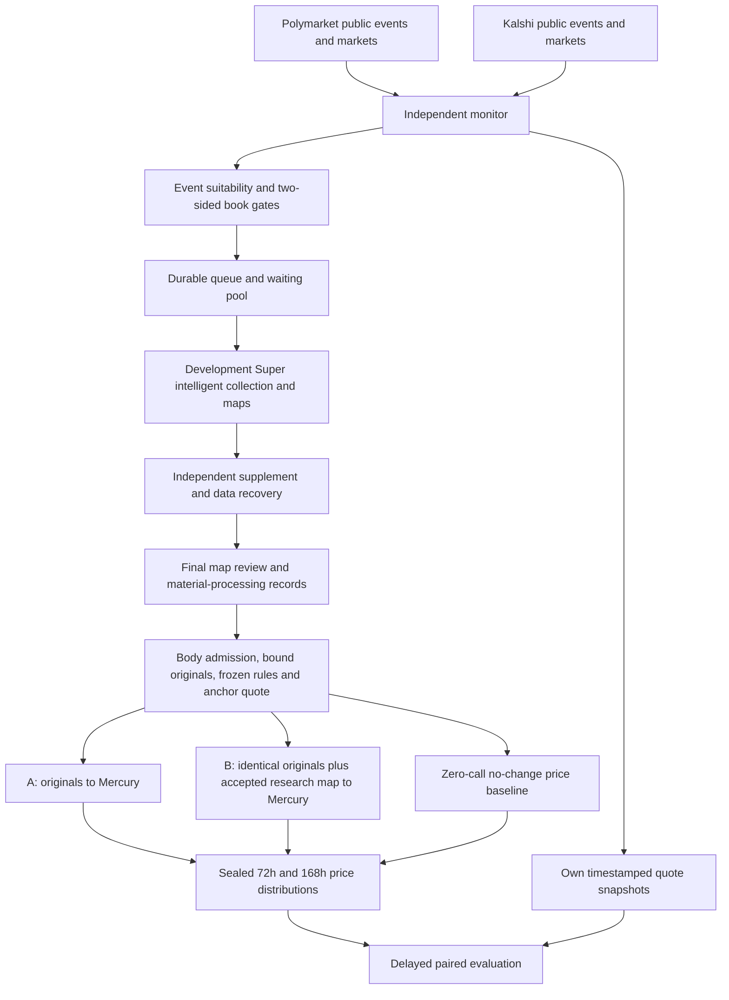

# Market repricing development pilot v2

An independent, read-only Polymarket/Kalshi research sidecar. It has no trading
or Metaculus delivery entry point. Production competition workflows stay separate.

## Selected engine: latest development, not Release

| Layer | Implementation |
| --- | --- |
| Engine branch | `codex/official-intelligence-v106` |
| Exact development snapshot | `c17c1ec4ee3e2458108031a324b45853aa9e7502` |
| Collection entry | `intelligence.pipeline.collect` |
| Capabilities | Native channels, Super acquisition/map fusion, predictive focus, reference binding, scoring delivery |
| Recovery | Independent supplement, data-resource recovery, final-map material processing |
| Analysis inputs | `intelligence.admission.prepare` and `research_loop.prospective_trial.prepared_pair` |
| Analysis transport | Development `research_loop.decision_http` |
| Collection model | `nvidia/nemotron-3-super-120b-a12b:free` |
| Decision model | `inception/mercury-decide:free`, `/api/alpha/decisions` |
| New target adapter | `development-map-price-grid-v2` |

The sidecar branch is `codex/market-repricing`. Actions checks out the exact
development snapshot into `.development`. `runtime.activate` verifies the commit,
tracked-tree cleanliness and implementation identity, then loads every existing
dependency from that development tree. It does not check out or fall back to a
Release tag. Historical shared helpers in the development tree retain their
audited budgets; this reuse does not make the development candidate a Release.
Update the explicit pin and identity for each new experimental engine.

Numeric collector IDs are internal compatibility IDs, paired with namespaced
venue IDs and marked `synthetic_compatibility_id=true`, never submission IDs.

## Flow



Maps are built during acquisition and final material processing. There is no
additional independent brief request after collection. Both scoring arms share
identical admitted original text and the same event/future-price heads; the map
is the added field in B. Development projection binds quotes, reference IDs,
source scope and unknown predicates. Unsupported or oversized maps become an
explicit original-only fallback, never a fabricated map. Such cases are not
successful map-vs-original comparisons.
When no accepted map is deliverable, B is `not_comparable` and consumes no
additional scoring request. The available A forecast is retained; map-contrast
metrics exclude these cases and report the missing-map count explicitly.

Each arm has one lifetime Mercury request. Failed journals remain saved. The
new price adapter does not silently route through Release or invent a price.
Missing-arm attrition and original-only availability are explicit.

## Targets and freeze

Event probability and future market price are separate. Mercury receives the
development event head and predictive choice heads for 72 and 168 hours. Each
price head distributes mass over 21 representative prices from 0 to 1 in 0.05
steps. Its expectation is the price forecast, not an independent event probability.
This grid is an approximation. Event probabilities retain the 0.02–0.98 clip;
price means do not silently inherit that event-probability clip.

The development map describes world events and evidence. The additional price
heads reason about information traders may absorb during each horizon. Map
conditions are not automatically market-price distributions or verified causes.

The anchor is observed after collection and final material processing. Inference
cannot use later evidence. Seal latency is capped at 30 minutes. A label uses the
latest usable quote in the 30-minute window ending at `anchor+72h` or
`anchor+168h`. Later quotes cannot fill a missed window. Early resolution, rule
changes, missing windows, failed arms and late forecasts remain explicit.
No-change predicts the anchor midpoint at both horizons. Paired MAE/RMSE compare
all arms on the same available cases. Eventual Brier and trading PnL are separate;
no predictive skill is claimed before delayed labels exist.

## Selection

Event discovery avoids saturation by crypto and sports launches. Polymarket
exclusion tags are resolved by slug. Kalshi uses nested events with a minimum
close time. A bounded newest-market overlap observes new children of old events.
Page caps retain `complete=false`, not a claim of complete venue coverage.
Creation date, first seen/tradability, metadata/rules versions and raw receipts
are saved. A domain match is `plausible_unconfirmed`, not an invented confirmed
catalyst date. Platform close hints are not authoritative event deadlines.
Unknown relevance, missing rules and liquidity remain in waiting pools.

New test questions must have a platform creation timestamp within the rolling
last 24 hours at enrollment. Updated timestamps and first-seen time cannot make
an old question new. Expected resolution must be at least 168 hours away and
platform trading close must also leave 168 hours. Kalshi expected expiration is
recorded separately from order close. Polymarket requires an explicit dated rule
deadline agreeing with the metadata date; it is a deadline estimate, not a
guarantee against early settlement. A rule-delegated title date can also qualify
when title month/day, explicit 11:59 PM ET rule time and platform timestamp agree
in America/New_York. The platform supplies the matched year; DST and year rollover
are checked. A mismatch or missing explicit delegation remains unknown.
Unknown resolution time waits for rules.
The 7-day condition is checked again at the price anchor; creation eligibility
remains frozen at enrollment, so an hour-long retry does not relabel the question.

Platform close hints must be 7–90 days away. Exclude crypto (including
companies, ETFs and regulation), sports/esports, social counts and pure price
wagers. Composite contracts/title conjunctions are conservatively excluded from
the first single-event pilot. Rejections and shortfalls are retained.

Books require two sides, spread <= 0.08 and top size >= 20 on both sides.
Polymarket uses the actual YES asset, including reversed outcome arrays. Kalshi
fixed-point YES ask is `1-max(NO bid)` with the corresponding size. Ambiguous
cent schemas are not guessed. Display prices/last trades are not book snapshots.

At most three venue event families enter this finite pilot, three per UTC day
and three per dispatch. Each family gets a quote turn before additional thresholds.
Cross-venue title similarity does not establish rule equivalence.

## Actions, budgets and recovery

- `market_research_monitor.yaml`: public discovery/quotes/labels, no model secrets.
- `market_research_worker.yaml`: selected development collection/maps and scoring.
- `market_repricing_tests.yaml`: independent offline and actual development gates.

Automatic jobs require `MARKET_REPRICING_ENABLED=true`. Monitor schedule: 15
minutes. GitHub can delay runs; missed windows stay missing. An external cron
can dispatch instead, with the built-in schedule removed for a single-source test.

```text
POST https://api.github.com/repos/chenencc/futureeval-forecasting-agent/actions/workflows/market_research_monitor.yaml/dispatches
Authorization: Bearer YOUR_GITHUB_TOKEN
Content-Type: application/json
{"ref":"main"}
```

Use OPENROUTER2 only, with no production router-key fallback. Search credential
names: `TAVILY_KEY1/TAVILY_KEY2`, `EXA_API/EXA_API2`. Development collection retains
initial lifetime limits of three Tavily basic searches and one Exa search per
task; capture/Extract/supplement have separate existing limits. Remaining model
decision/failure reservations are restored across retries. Outer physical limits:
200 model and 20 search requests per dispatch, 400 model requests per UTC day,
60 model requests per task. Errors/unknown attempts consume reservations. At
most three executions, at least an hour between retries; no backend budget reset.
Linux research tasks have a 45-minute outer deadline, enclosing the development
collector's own shorter limits. Empty queues and verification-only runs skip the
browser dependency installation and all model calls.

Role-specific v2 artifacts prevent mixing ledgers or resuming the Release pilot.
Restore checks workflow/repository/branch, archive members and file hashes. A
missing latest mutated checkpoint fails closed. Terminal tasks do not recollect.
V1 probes remain historical evidence, not adopted v2 acquisition/analysis results.

Artifacts preserve compressed raw responses, collector/supplement journals,
maps/material-processing records, body admission, matched scoring inputs,
provider requests/responses, anchors, labels and gaps. `ForecastAgent.local_sync`
can archive completed Actions artifacts into `E:\metaculus_data`; actual sync
must complete before claiming local archival. Ninety-day artifact retention and
a finite pilot are not an unlimited durable cloud database.

## Verification

```text
python -m unittest discover -s ForecastAgent/market_repricing/tests -v
MARKET_ENGINE_DIRECTORY=/path/to/development python -m ForecastAgent.market_repricing.tests.verify_development_runtime -v
python -m ForecastAgent.market_repricing monitor --root snapshots/market-monitor-v2
python -m ForecastAgent.market_repricing.runtime --engine .development --root snapshots/market-worker-v2 --monitor snapshots/market-monitor-v2 --verification-only
```

Credential-free fixtures verify wiring/invariants, not live provider success or
predictive skill. Enable a bounded model pilot after reviewing real candidates.
