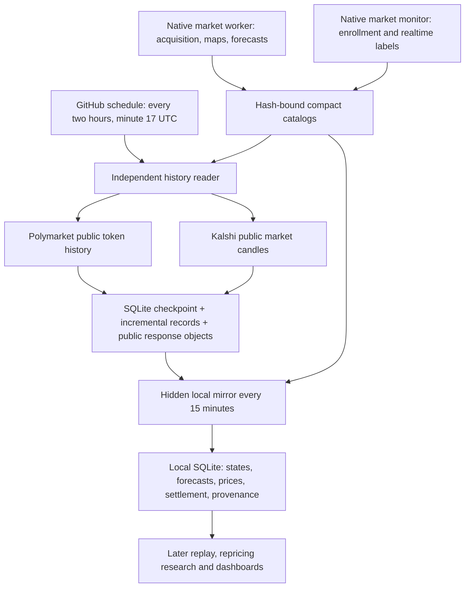

# Market store and two-hour public price history

This module is independent of the selected forecasting engine. It never calls
models, searches for evidence, trades, submits forecasts, reopens collection tasks,
or changes native evaluation labels. Only enrolled markets enter this database.

## Architecture



### Free storage choice

SQLite is public domain and uses the Python standard library. It needs no server
or subscription. WAL supports readers alongside the single writer. The existing
generic archive index is not modified. Large source bodies and provider/model
records remain in the existing SHA-256 archive or GitHub task packs; the new store
indexes their exact hashes and availability, rather than duplicating them in SQL.
GitHub-hosted standard runners are free for a public repository, subject to GitHub
artifact/storage policies and account storage allowances. New history artifacts
have seven-day retention, not permanent storage. This is independent of the
existing evidence artifacts and does not shorten their retention.
The local mirror and backups are therefore the durable research copy.

Default local database:
`E:/metaculus_data/prediction_markets/store/market.sqlite3`.

## Data contract

| Table / view | Meaning |
| --- | --- |
| `markets` | Frozen venue ID, YES token, event family, condition, creation clock and original rules |
| `task_versions`, `task_observations` | Deduplicated acquisition/analysis payloads and source-run observations |
| `latest_tasks`, `latest_discovery` | Worker and monitor observations remain separate |
| `forecasts` | Immutable predictions by arm, sealed clock, probability, price heads and response hashes |
| `revisions` | Independently timestamped local supplemental materials and their forecast vintages |
| `native_tracking`, `realtime_quotes` | Original creation-relative labels and actual contemporaneous order books |
| `material_refs` | Exact source/model/map/archive paths and hashes; a remote reference is not a local body |
| `venue_observations` | Public status, explicit settlement result, actual read clock and raw response SHA |
| `price_points`, `latest_prices` | History values and revisions with point clock, retrieval clock, kind and resolution |
| `history_windows` | Complete nonempty, complete empty, or failed public history requests and receipts |
| `cursors` | Last completely scanned boundary, latest returned point, retry deadline and finalization |
| `records`, `imports` | Idempotent replication and import provenance |
| `market_overview` | Separate pipeline, venue, history and forecast availability, not one ambiguous completion flag |

The workflow restores its own compressed SQLite checkpoint, retaining control
state and only the overlapping price cache needed for the next scan. It emits a
compressed JSONL delta and raw public responses before pruning that cloud cache.
The local database is never pruned. The local mirror uses range reads and SHA
caches, imports every unimported delta oldest-first, and records missing/expired
publications explicitly. A gap beyond retention cannot be declared recovered
from the hot checkpoint alone.
It never downloads the cumulative native evidence ZIP. Public response objects
from imported history checkpoints are copied locally by hash; original acquisition
body references keep their explicit remote availability until separately synced.

## History policy

- Unresolved includes trading-closed, awaiting settlement and disputed markets.
  A 0/1 last traded price or a passed close date is not a resolution result.
- Polymarket requests bind the frozen YES token and condition to public metadata.
  Kalshi requests bind exact market, event and series identities.
- First collection backfills from platform creation, at most one day per market
  per dispatch, while also capturing the latest two-hour tail immediately. The
  contiguous historical cursor and live tip are separate. Later requests overlap
  the successful boundary by two hours.
  Oldest incomplete scans run first. A failed market does not stop other markets.
- Recent Polymarket points use 60 seconds. Older windows use explicit 300, 1800,
  or 10800 seconds according to conservative documented retention floors. Every
  returned point retains its actual provider resolution. No interpolation.
- Polymarket resolution-zero terminal points use a distinct unbucketed kind:
  they can be the latest tick of an unresolved market. Neither a zero resolution
  nor a displayed 0/1 price proves settlement; only explicit bound CLOB winners
  populate a binary resolution result.
- Kalshi bid/ask-close midpoint and trade close are distinct series. The current
  fixed-point dollar fields are required; cents are never guessed from magnitude.
- Cursors advance only after a fully paginated successful response. Empty windows
  are explicit and do not prove there was no trading. Truncation and malformed
  schemas fail that window. HTTP 429 honors a bounded Retry-After and stops the
  dispatch. Public requests default to 600 per dispatch and a 20-minute wall clock.
- After explicit settlement, finish the tail backfill once, then stop polling.
- All history is retrospective. It never replaces admission-time order books,
  original forecast inputs or contemporaneous +1/+3/+7-day evaluation snapshots.
  Future research can sample at creation +24/+72/+168 hours, with observed price
  age, grain and missing coverage disclosed.

## Operations

```powershell
python -m ForecastAgent.market_store.cli sync
```

Install the hidden local task using `integrations/install_market_store_sync.ps1`
with the existing Python and authorized GitHub CLI paths. The local computer must
be online and logged in; missed imports catch up within retention, with expiry
gaps disclosed. `latest-sync.json` is the
local health record. The two-hour GitHub schedule is independent of the existing
external discovery cron. GitHub schedules can run late; cursors recover delayed
windows, but the schedule is not a timing guarantee.

For a consistent manual backup use Python `sqlite3.Connection.backup`, rather
than copying a live WAL database file alone. Do not commit a database or secrets.

## Official references

- https://www.sqlite.org/copyright.html
- https://www.sqlite.org/whentouse.html
- https://data-api.polymarket.com/v2/openapi.json
- https://docs.kalshi.com/api-reference/market/get-market-candlesticks
- https://docs.kalshi.com/api-reference/historical/get-historical-market-candlesticks
- https://docs.github.com/en/actions/reference/workflows-and-actions/events-that-trigger-workflows
