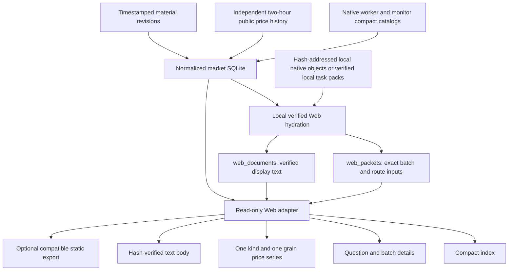

# ForecastAgent Web database contract

Contract: **market-web-database-v1**
Owner: Pipeline; consumer: the Web lane, chat `01a1240d-cd6f-7af1-9c0f-8972f68142ed`.
Canonical repository document: `ForecastAgent/market_store/WEB_DATABASE.md`.
Installed handbook: `E:/metaculus_data/prediction_markets/store/WEB_DATABASE.md`.

This is the self-contained implementation guide for Web development. It includes
scope, the actual schema, JSON contracts, read APIs, time/hash semantics, status
mapping, security, migration and acceptance checks. It describes implemented
Python adapters separately from HTTP endpoints that the Web service must wire.

## 1. What is ready and what is not

The prediction-market database supports the existing daily table, question/rules
detail, per-batch A/B/C predictions, actual decision evidence, archived full-text
reading, saved research graphs, price history, native follow-up labels, and
provenance/gap presentation. Read this document before choosing data fields.

The original 16-table database was not sufficient on its own for decision-bound
Intelligence. The additive local Web extension supplies `web_packets` and
`web_documents`. Its reader verifies saved native material, decision state and
result bindings before creating a display packet. It does not ingest rendered
HTML or use the frontend's generated JSON as an authoritative prediction source.

**Not every market has locally synchronized evidence.** The UI must render that
state accurately. Missing bodies do not mean acquisition failed, and an existing
forecast does not prove the corresponding source package is imported.

This contract does not change acquisition, model prompts, forecasts, submission,
trading, or quotas. It does not deploy or automatically rewrite the Web UI.

### Verified local acceptance snapshot

Verified at `2026-10-15T03:40:39.864804+00:00`. Counts are an observed snapshot, not permanent limits.

| Measure | Verified value |
|---|---|
| Dedicated tables / views | 18 / 6 |
| Markets / forecast batches | 72 / 90 |
| Display documents, hash-checked | 377 |
| Packet `pack_not_synced` | 7 |
| Packet `saved_package_no_readable_body` | 1 |
| Packet `worker_material_available` | 82 |
| Route `model_input_verified` | 175 |
| Route `not_scored` | 55 |
| Route `pack_not_synced` | 19 |
| Native normalized data | All 15 original data-table row hashes unchanged during hydration |
| SQLite integrity / foreign-key violations | ok / 0 |
| Storage and Web-adapter tests | 31 passed |
| Actual current Web component checks | 72 markets, 360 detail section renders, 83 material batches, 249 route checks |
| New model / search / download calls for hydration | 0 / 0 / 0 |

The seven native packages still awaiting local import remain explicit gaps. Of the 90 batches, 18 are indexed independent material revisions.
The extension does not claim that all historical revision folders are indexed or all three routes have a verified input.
Browser/backend wiring remains Web-owned: this acceptance rendered the existing components against the new export in isolation; it did not change the live UI.

Acceptance report: `E:/metaculus_data/reports/market-web-database-contract-20261015.json`.

## 2. Data locations and ownership

| Item | Location / meaning |
|---|---|
| Prediction-market SQLite | `E:/metaculus_data/prediction_markets/store/market.sqlite3` |
| Independent mirror health | Same directory, `latest-sync.json` |
| Web hydration policy | Same directory, `web-material-policy.json` |
| Public/native verified objects | Same directory, `objects/<sha-prefix>/<byte-sha256>` |
| Existing general native blob archive | `E:/metaculus_data/blobs/sha256/<prefix>/<byte-sha256>` |
| Timestamped material revision files | `E:/metaculus_data/prediction_markets/revisions/` |
| Base database implementation | `ForecastAgent/market_store/store.py` |
| Verified material projection | `ForecastAgent/market_store/web_materials.py` |
| Read-only consumer functions | `ForecastAgent/market_store/web_read.py` |
| Current Web implementation | `D:/metaculus/.tmp/forecastagent_cloud` |

The Web lane owns `apps/web` and its HTTP/static serving integration. Pipeline owns
the database, hydration, native artifact binding and forecasting semantics. This
implementation does not import the Web repository or require its code at runtime.
A previously saved hash-addressed Web-native cache can be used as an optional
one-time source of verified original objects; those objects are copied to the
canonical local store and do not remain dependent on that cache.

### Other streams

This SQLite file contains **enrolled Polymarket and Kalshi research contracts**.
It does not contain the entire public market universe or excluded discoveries.
MiniBench and official Metaculus competition streams retain their existing
read-only native archive adapter. Their generic archive index is
`E:/metaculus_data/index.sqlite3`; its actual schema is included in the final
appendix. Never infer that a market forecast is a Metaculus submission receipt.

The Web router should keep `minibench`, `official`, and `prediction_markets`
separate. Do not expose unrelated historical debug campaigns. Orders, payments
and entitlements belong to the separate Web service database, not this research
database. The generic archive index is large: do not scan its `records.body_json`
table to implement the new market UI. Use the dedicated market database.

## 3. Architecture



The local 15-minute mirror can hydrate already saved materials when enabled by
policy. No frontend request is allowed to run hydration, download archives,
search, call models, repair tasks or submit/trade. Cloud price history is every
two hours; its seven-day increment retention is separate from native evidence
retention. The local database is not pruned by the cloud overlap-cache policy.

## 4. Three identities that must stay separate

1. **Market key:** `polymarket:<id>` or `kalshi:<ticker>`. Venue, frozen YES asset,
   event family, condition and creation clock identify the proposition.
2. **Batch:** `initial_worker` or a recorded independent `revision_id`, always
   namespaced by market key. A batch owns its evidence, graphs and forecasts.
3. **Route:** `original`, `mapped`, `official_map` within one batch.

`forecast_fingerprint` binds a packet to recorded route status, probability,
price heads, response/state hashes and recorded seal clocks. A packet from a
different fingerprint must never be attached by market title, latest date,
array position, matching URL alone, or merely because it contains useful text.

| Route | Web label | Meaning |
|---|---|---|
| `original` | A: direct evidence | Saved original decision input without a research map |
| `mapped` | B: our research map | Its saved evidence and our map, when actually supplied |
| `official_map` | C: reference map | Reference-implementation research map plus its saved decision input |

C is **not a Metaculus platform forecast**. A route name does not prove which
model ran. Display a model name only if saved metadata records it; otherwise use
`not_recorded`. Never average routes in the UI without an explicit saved result.

## 5. Implemented read APIs

Import from `ForecastAgent.market_store.web_read`:

```python
from ForecastAgent.market_store.web_read import (
    open_readonly, read_watermark, read_index, read_task,
    read_history, read_body, publish_snapshot,
)

root = 'E:/metaculus_data/prediction_markets/store'
db = open_readonly(root)  # SQLite mode=ro and PRAGMA query_only=ON
try:
    db.execute('BEGIN')  # coherent short WAL read transaction
    index = read_index(db)
    detail = read_task(db, 'polymarket:5676514', with_history=False)
    prices = read_history(db, 'polymarket:5676514', resolution=60, limit=10000)
    db.rollback()
finally:
    db.close()
```

| Function | Contract |
|---|---|
| `open_readonly(root)` | Opens existing SQLite only; never initializes or migrates schema |
| `read_watermark(db)` | Stable source-record/Web-verification hash for cache invalidation |
| `read_index(db)` | Lightweight market rows, prediction batches and counts; no full bodies, maps or history |
| `read_task(db,key,with_history=True,with_materials=True)` | One market, exact batches, packet availability and actual selected materials |
| `read_history(db,key,kind=None,resolution=None,before=None,limit=10000)` | One venue-valid price kind and one recorded resolution; strict earlier-page cursor |
| `read_body(db,display_sha256)` | Verified UTF-8 bytes from `web_documents`; validates size and SHA before returning |
| `read_catalog(db,with_history=False)` | Full legacy-compatible research DTO; use index/detail endpoints for routine polling |
| `publish_snapshot(db,output)` | Explicit local export only; not a function for an HTTP GET handler |

`KeyError` means unknown market or unavailable display body; map to 404.
`ValueError` means invalid parameter or integrity failure; do not substitute a
different body/market/batch. A service may use 400 for parameters and a distinct
integrity error code for stored-data failures. Keep the last good frontend
snapshot on refresh failure and label the failure.

### Suggested HTTP mapping: Web-owned, not installed by this module

| GET route | Handler |
|---|---|
| `/api/research/markets` | `read_index` |
| `/api/research/markets/{encoded_key}` | `read_task(..., with_history=False)` |
| `/api/research/markets/{encoded_key}/prices` | `read_history`, validated kind/resolution/before/limit |
| `/api/research/bodies/{display_sha256}` | `read_body`, `text/plain; charset=utf-8`, `nosniff` |

Browser parameters must never be SQL identifiers, local paths, archive member
paths or executable commands. Use bound SQL values. Do not serve SQLite itself,
its WAL/SHM, native requests, model responses or the generic archive over HTTP.

## 6. Compatibility with the current Web code

The full exporter returns `schema: prediction-market-web-v1`, retaining the
current `MarketTask`, `revisions[].forecast`, `revisions[].materials`, A/B/C
evidence, graph and `SavedSource` shapes. It writes:

```text
output/
  market-research.json
  market-price-index.json                 # market-web-price-index-v1
  prices/<SHA256-of-exact-JSON-bytes>.json
  bodies/<SHA256-of-exact-UTF8-bytes>.txt
```

Serve `output` as the existing private `/data/` location. `body_ref` stays
`data/bodies/<hash>.txt`; price-index paths stay `prices/<hash>.json`. Both mutable
index names are replaced atomically after immutable content is written. Price
refresh is independent of an immutable prediction batch; it does not change the
batch's evidence clock. A consistent read transaction supplies each export.

```powershell
python -m ForecastAgent.market_store.web_read export `
  --root E:/metaculus_data/prediction_markets/store `
  --output D:/metaculus/.tmp/market-web-preview
```

The new exporter does **not** change the current Vite server or its data directory.
Web must explicitly switch the data source. Do not leave the old
`market-price-index.json` active while serving a new database-backed research
snapshot: the existing history hook can otherwise replace fresh fallback history
with an older independently generated series.

### Required consumer adjustments

- `MarketPriceChart.tsx` and `useMarketHistory.ts` currently assume a 30-minute
  stale threshold. For this source use the provided `interval_seconds=7200` plus
  a documented scheduler grace period, rather than the old ten-minute collector's
  constants. Show price freshness separately from 15-minute metadata sync.
- For compact index rows, use `readable_sources_count`; an omitted materials
  payload is not an empty acquisition result. `materials_included=false` means
  detail was intentionally omitted, not unavailable.
- Treat `provider_unbucketed_terminal_point` as an optional separate series.
  The default chart uses the venue's regular historical series, not this tip.
- Keep pending/missing route inputs empty. Existing per-arm rendering supports
  the packet shape; do not restore the legacy shared-evidence fallback.
- MiniBench/official streams keep their existing adapter and confirmed-receipt
  semantics; this is not a migration of those datasets.

## 7. Market/detail JSON fields

| Field | Meaning |
|---|---|
| `key`, `venue`, `venue_id`, `url`, `title`, `rules` | Frozen identity and safe public link |
| `created_at` | Platform creation timestamp; not discovery/admission time |
| `close_at`, `resolution_hint` | Preserved native metadata; close is not guaranteed settlement time |
| `first_seen_at` | Currently null where absent; never fill with admission time |
| `enrolled_at` | Recorded admission clock |
| `worker_status` | Preserved native worker status |
| `effective_model_status` | Presentation status derived from a completed selected batch |
| `selected_revision_id` | Latest batch containing at least one completed valid route; latest attempted batch if none complete |
| `local_material_status`, `readable_sources_count` | Selected packet's local import state and count |
| `status_observed_at` | Latest worker catalog observation, not evidence capture |
| `executions`, `retry_at`, `error_type`, `analysis_stage` | Saved native process diagnostics |
| `opening_quote`, `opening_status` | Null/not_recorded unless an actual opening observation is saved |
| `earliest_quote`, `latest_quote`, `quote_history` | Indexed actual anchor/follow-up quotes, not the entire raw quote archive |
| `quote_history_scope` | Currently `indexed_forecast_anchors_and_native_target_window_quotes` |
| `prices` | Native creation-relative follow-up states at 24/72/120/168h; 120h is normally unscheduled |
| `revisions` | Explicit saved forecast batches with their own materials |
| `history` | Optional independently retrieved retrospective price series |
| `sources`, `graph`, other top-level material fields | Selected-batch convenience fields; prefer `revisions[]` for analysis/detail |
| `venue_status`, `final_result` | Latest explicit public venue observation; unresolved result is null |

An old `baseline_only` task can have `effective_model_status=completed_after_supplement`.
The native task is not rewritten. UI counters must distinguish those concepts.

### Batch fields

`id`, `source_kind`, `label`, `result_sha256`, `sealed_at`, `forecast`,
`forecast_fingerprint`, `materials`, `material_status`, `material_verified_at`,
`materials_included`, `source_count`, `import_error`.

`source_kind` is `original_worker` or `material_revision`. A material batch change
selects its own evidence, graphs and predictions together. A missing packet never
attaches another revision's readable documents. `material_verified_at` is the
latest local verification clock, not a new capture or prediction.

### Forecast fields

`forecast.arms[arm]` retains status, reason/error when recorded, final-event
`eventual_probability_yes`, future `price_means`, map delivery/status,
response/state hashes and actual individual `sealed_at` where saved.
The enclosing forecast keeps `anchor_at`, `anchor`, `sealed_at`, `price_schedule`,
`forecast_before_targets`, timing status and completion metadata when recorded.

Do not coerce null to zero. Zero and one are valid saved market probabilities.
Do not clip or recompute them in the display adapter. A completed route requires
`status=completed` and a finite numerical probability in [0,1]. Keep failed and
`not_comparable` routes with absent probabilities.

## 8. Intelligence: exact decision inputs

Use **only** `revision.materials.evidence_by_arm[arm]` and
`revision.materials.sources_by_arm[arm]` for the primary Intelligence reader.
These three route keys always exist, including empty arrays. `evidence` and
`scoring_sources` remain empty compatibility fields in the new packet, preventing
implicit substitution of shared or collected-only material.

`materials.sources` is the set of readable saved documents in that packet. It is
not the list of documents actually supplied to every decision. Bind each scoring
source to a display source by **exact URL plus original body SHA-256**, not by
source ID: scoring IDs and display IDs can differ.

| Evidence field | Meaning |
|---|---|
| `evidence_id`, `source_id` | Native evidence/reference identity |
| `text` | Saved model-input excerpt, with display redaction if required |
| `start`, `end` | Original saved-body character coordinates, when recorded |
| `sources_by_arm[].url`, `body_sha256` | Exact underlying source identity |
| `capture_metadata` | Native capture/publication metadata when present; no invented date |
| `saved_body_truncated` | Preserve native truncation information |

Coordinates are Python Unicode character offsets (end exclusive), not UTF-8 byte
offsets or JavaScript UTF-16 indexes. For supplementary-plane characters use a
code-point-aware slice if revalidating in JavaScript. A saved excerpt can be
confirmed as model input while its original-body span remains unverified; such
cases are retained in `gaps` as `saved_excerpt_span_not_verified`.

`route_statuses[arm]` explains whether the actual input is `model_input_verified`,
`pack_not_synced`, `integrity_failed` or `not_scored`. A failed route binding does
not remove the other verified routes. A saved prediction remains visible when
its input is unavailable, with that availability gap displayed separately.

Keep paragraphs, explicit tables, numeric rows and PDF page labels intact.
Do not generate a new summary, rerank sources, infer publication dates, or run
truth/relevance checks in the page. Search/fetch/plan diagnostics belong in the
collapsed provenance view, not the main Intelligence reader.

## 9. Full text and research graphs

Each display source contains `id`, `url`, `title`, `characters`, `body_sha256`,
`captured_at`, `excerpt`, `excerpt_truncated`, `supplemented`, `body_ref`,
`display_sha256`, and `body_redacted`. `body_sha256` identifies the original
source. `display_sha256` identifies exact redacted UTF-8 display bytes.

`web_documents.text` contains that verified display text directly. Thus the Web
does not need to open arbitrary local files or unpack native archives to read an
imported body. Backend `read_body` verifies hash/length; browser `SavedBody`
should continue validating the returned bytes against `display_sha256`.
Serve plain text only. Do not execute archived HTML, inject source text using
`dangerouslySetInnerHTML`, or use an arbitrary `body_ref` as a local path.

`materials.graphs[arm]` contains that arm's saved graph actually present in the
verified decision state. `materials.graph` is a B-route convenience field; it
must not be borrowed as a missing C graph. Graph wrappers are normalized to the
saved graph object, with original status, nodes, relations/edges, evidence IDs,
literal bindings, interpretation, limitations and target links retained.

The graph is stored as versioned JSON inside `web_packets.payload`; there are no
independent SQL graph-node/edge tables. Both array and ID-keyed node maps are
supported by the current renderer. A research graph is not automatically a
calibrated causal graph, a factual verification result or a conditional-probability
distribution. Display only numerical relations explicitly recorded in it.

## 10. Time, price and result semantics

| Clock | Source / display rule |
|---|---|
| Creation | Frozen `markets.created_at`; basis of native creation-relative targets |
| Capture | Per-source native retrieval/capture metadata |
| Freeze | `materials.frozen_at` if recorded; otherwise null and show latest capture separately |
| Prediction | Route's own `forecast.arms[arm].sealed_at` when saved |
| Batch | Enclosing `forecast.sealed_at`; fallback label must say batch time only |
| Price point | `price_points.point_at`, UTC epoch seconds |
| Price retrieval | `price_points.observed_at`, later retrospective read clock |
| Status observation | Catalog observation or venue read, not event occurrence |
| Verification | `web_packets.observed_at`, local recheck time only |
| Resolution | Explicit bound winner/result; actual settlement time only if provider records one |

**Important SQL caveat:** `forecasts.sealed_at` is a convenience column that can
fall back to batch seal time. For an individual route clock use
`forecasts.data.value.sealed_at` only when present, or the detail DTO route field.

Historical series are separate from contemporaneous order books and native
evaluation labels. A fetched historical point is not opening price, an executable
quote, evidence available at the earlier prediction time, or a replacement for a
missed 1/3/7-day label. Do not carry a last price forward or interpolate a missing
target. Day 5/120h is display-only unless explicitly scheduled natively.

| Price kind | Meaning |
|---|---|
| `provider_history_price` | Regular Polymarket public history |
| `provider_unbucketed_terminal_point` | Unbucketed latest/tip observation, including unresolved markets; not settlement proof |
| `candle_bid_ask_close_midpoint` | Kalshi YES bid/ask candle-close midpoint |
| `candle_trade_close` | Kalshi traded candle close, a separate series |

`read_history` defaults to the regular Polymarket series or Kalshi midpoint and
the finest recorded resolution for that kind. Different grains are never silently
joined into one line. `available_series` enumerates other kind/grain choices.
Use `selected_resolution_seconds` in legends. Follow `pagination.next_before`
until `truncated=false` to request earlier pages; do not label the first bounded
page as complete lifetime coverage.

`cursors.scanned_until` is contiguous historical coverage. The separate
`cursors.data.live_scanned_until` can be current while older backfill remains.
A complete-empty API window does not prove no trading. `final_result` stays null
until explicit venue proof; do not infer it from a passed close or 0/1 price.
Use native `tracking.final.eligible_for_event_brier` and matching rule versions
before calculating event scores. Market-price movement alone is not event accuracy
or trading profit.

## 11. Status and error display matrix

| Stored condition | UI meaning |
|---|---|
| Worker running/retry; no forecast | Acquisition/analysis pending; probability absent |
| Completed forecast, material packet missing | Score available; matching evidence awaiting local import |
| `worker_material_available` | Readable saved documents available; not a truth/relevance certificate |
| `saved_package_no_readable_body` | Matching package verified, no readable body admitted |
| `pack_not_synced` | Local import gap; do not call it failed acquisition |
| `integrity_failed` | Do not display affected evidence or graph; preserve score and show binding error |
| Route `not_scored` / `not_comparable` | No completed model score for that route |
| Baseline-only native task plus later revision | Preserve native status; separately show recovered later prediction |
| History `backfill` | Earlier history incomplete; live tip can already be current |
| History `retry_wait` | Retain old observations and show the retry clock |
| `missing_window_quote` | Native target quote missed; retrospective display cannot alter its score label |
| Missing usage/cost | null/not_recorded, never an invented zero |

## 12. Useful read-only SQL

```sql
-- One row per tracked market, independent process/venue/history states.
SELECT * FROM market_overview ORDER BY created_at DESC;

-- Per-route completed outputs, preserving unavailable/non-comparable rows separately.
SELECT market_key, arm, probability_yes, status,
       json_extract(data,'$.value.sealed_at') AS actual_route_sealed_at,
       json_extract(data,'$.value.price_means') AS future_price_heads,
       json_extract(data,'$.revision_id') AS revision_id
FROM forecasts WHERE market_key = :market_key;

-- A packet MUST match the backend-computed exact forecast fingerprint.
SELECT material_status, payload FROM latest_web_packets
WHERE market_key=:market_key AND batch_id=:batch_id
  AND forecast_fingerprint=:forecast_fingerprint;

-- Graph and decision input, namespaced by the same packet and route.
SELECT json_extract(payload,'$.materials.graphs.mapped') AS graph,
       json_extract(payload,'$.materials.evidence_by_arm.mapped') AS evidence,
       json_extract(payload,'$.materials.sources_by_arm.mapped') AS scoring_sources
FROM latest_web_packets
WHERE market_key=:market_key AND batch_id=:batch_id
  AND forecast_fingerprint=:forecast_fingerprint;

-- Preserve one kind and one grain; bind all request values.
SELECT point_at,price,bid,ask,observed_at,response_sha256
FROM latest_prices
WHERE market_key=:market_key AND kind=:kind
  AND resolution_seconds=:resolution AND point_at<:before
ORDER BY point_at DESC LIMIT :limit;

-- Native labels and gaps remain the original saved JSON.
SELECT observed_at,data FROM native_tracking
WHERE market_key=:market_key ORDER BY observed_at DESC LIMIT 1;
```

There is no built-in SQLite SHA-256 function assumed by this contract; use the
provided Python `fingerprint`/`read_body`, not a nonexistent SQL hash expression.

## 13. Hash glossary

| Identifier | Exact hash input |
|---|---|
| File/object SHA | Original file bytes, as in `material_refs.sha256` |
| Source `body_sha256` | Original readable body encoded as UTF-8, without JSON quoting |
| Display SHA | Exact redacted UTF-8 bytes served to the browser |
| Native revision `result_sha256` | Canonical JSON result, not pretty-printed result-file bytes |
| Native state/material hash | Canonical JSON object using the producer's recorded scheme |
| Frozen rule hash | Native canonical JSON string hash; not raw rule-text bytes |
| `forecast_fingerprint` | Documented compact forecast/route/clock projection in `web_materials.fingerprint` |
| Price file SHA | Exact JSON bytes named by `market-price-index.json` |

Canonical JSON uses sorted keys, separators `(',', ':')`, `ensure_ascii=False`,
UTF-8 and no NaN. Some legacy request identities use a different explicitly saved
serialization; `validate_decision` preserves that native scheme. Never substitute
canonical JSON hashes for byte hashes. A supplemental graph-record hash can refer
to its wrapper record, while packet graph hash refers to the actual displayed
graph; retain the named provenance rather than comparing unrelated hash inputs.

## 14. Hydration and future synchronization

Hydration is an explicit local maintenance operation, never an HTTP handler:

```powershell
python -m ForecastAgent.market_store.web_read hydrate `
  --root E:/metaculus_data/prediction_markets/store
```

It reads exact indexed objects, verifies local task pack bytes when needed, and
copies only declared native JSON objects to the canonical local cache. It rejects
archive traversal, links, duplicate members, overlarge objects and hash mismatch;
it never uses `extractall`. A malformed route does not erase the other routes.
It can use bounded optional `--object-root` directories for already saved native
objects. Those directories are not served to the browser.

The optional mirror policy is local JSON:

```json
{"enabled":true,"object_roots":[]}
```

With this policy, the existing hidden 15-minute local mirror hydrates newly
available material after importing catalogs, price deltas and local revisions.
New markets remain visible while their task packs are unavailable. Hydration does
not start a missing archive download. Acquisition retries and model budgets are
owned by their native worker, never by Web refresh.

## 15. Caching, concurrency, privacy and deployment

- Readers use `mode=ro`, `query_only=ON` and short consistent read transactions.
  Never use `immutable=1` against the active WAL database or copy only its main
  file as a backup. Use SQLite online backup for consistent copies.
- Keep one local writer under the native task lock. Do not put active SQLite on
  a shared network filesystem. Close read transactions promptly to avoid WAL growth.
- Use `read_watermark` as the cache key/ETag. Cache DTOs per watermark, rather than
  rebuilding a full catalog every minute and treating a newly generated local
  timestamp as fresh source evidence. A stable watermark permits HTTP 304.
- Poll a compact index while visible; fetch detail and full body on demand.
  Retain last-good data on a failed refresh. Price refresh can remain independent.
- Maintain the existing private local/cloud access controls. The database and
  raw native archives are not public static assets or saleable reports by default.
  Only explicitly reviewed export manifests may go to a public deployment.
- Do not return API keys, request headers, raw prompts/private comments, capability
  tokens or absolute filesystem paths. Display text is plain text and redacted.
- Verify both server bytes and browser display hashes. Use safe HTTP(S) links
  without embedded credentials or authentication query parameters.

## 16. Current limitations and required acceptance

Some old experimental supplement vintages remain outside `revisions`. The Web
extension does not invent them or scan arbitrary experimental folders into the
production-selected batch. Exact original/archive references remain available.
Missing graph/evidence/usage stays missing; reading this handbook is not evidence
that an unavailable package was imported.

Before changing the Web data source verify:

1. Same market identity, frozen rules and route probabilities before/after.
2. Correct selected batch; switching it changes evidence, graphs and prediction
   together. Missing per-route inputs stay empty.
3. Exact URL + original-body-hash source binding; corrupted bytes are refused.
4. Unicode/PDF/table formatting; zero values retained; no private path/secret.
5. Correct actual route clock versus batch-only fallback.
6. Market curves keep kind/grain, explicit gaps and retrospective labeling.
7. Day 5 is unscheduled unless saved otherwise; no late replacement of labels.
8. Original baseline-only task and later recovered score remain distinguishable.
9. New index/body/price files are served together, and stale thresholds match 2h.
10. No providers, models, native writes, submissions or trades during GET/export.

Run adapter gates with:

```powershell
python -m unittest discover -s ForecastAgent/market_store/tests -v
```

## 17. Exact dedicated database schema

The following section is generated from the validated database's SQLite metadata.
It includes every table field, declared foreign key, index and view, and the
full DDL. JSON is stored as TEXT; observed nested payloads remain extensible.

### `cursors` (table)

Historical contiguous cursor, live tail, retry and terminal scan state.

| Field | SQL type | Nullable declaration | Primary-key order | Default |
|---|---|---|---|---|
| market_key | TEXT | not declared NOT NULL | 1 | — |
| scanned_until | INTEGER | not declared NOT NULL | — | — |
| last_point_at | INTEGER | not declared NOT NULL | — | — |
| retry_at | INTEGER | NOT NULL | — | 0 |
| status | TEXT | NOT NULL | — | — |
| data | TEXT | NOT NULL | — | — |

Foreign key: `market_key` → `markets.key`; update NO ACTION, delete NO ACTION.

Indexes:

- `sqlite_autoindex_cursors_1` (market_key); unique=true, origin=pk, partial=false.

```sql
CREATE TABLE cursors(market_key TEXT PRIMARY KEY REFERENCES markets(key),scanned_until INTEGER,
      last_point_at INTEGER,retry_at INTEGER NOT NULL DEFAULT 0,status TEXT NOT NULL,data TEXT NOT NULL);
```

### `forecasts` (table)

Immutable per-route output vintages; data retains original event and future-price heads.

| Field | SQL type | Nullable declaration | Primary-key order | Default |
|---|---|---|---|---|
| id | TEXT | not declared NOT NULL | 1 | — |
| market_key | TEXT | NOT NULL | — | — |
| arm | TEXT | NOT NULL | — | — |
| sealed_at | TEXT | not declared NOT NULL | — | — |
| probability_yes | REAL | not declared NOT NULL | — | — |
| status | TEXT | not declared NOT NULL | — | — |
| data | TEXT | NOT NULL | — | — |

Foreign key: `market_key` → `markets.key`; update NO ACTION, delete NO ACTION.

Indexes:

- `sqlite_autoindex_forecasts_1` (id); unique=true, origin=pk, partial=false.

```sql
CREATE TABLE forecasts(id TEXT PRIMARY KEY,market_key TEXT NOT NULL REFERENCES markets(key),
      arm TEXT NOT NULL,sealed_at TEXT,probability_yes REAL CHECK(probability_yes BETWEEN 0 AND 1),
      status TEXT,data TEXT NOT NULL);
```

### `history_windows` (table)

Attempted public history windows, completeness/error receipts and scan roles.

| Field | SQL type | Nullable declaration | Primary-key order | Default |
|---|---|---|---|---|
| id | TEXT | not declared NOT NULL | 1 | — |
| market_key | TEXT | NOT NULL | — | — |
| start_at | INTEGER | NOT NULL | — | — |
| end_at | INTEGER | NOT NULL | — | — |
| status | TEXT | NOT NULL | — | — |
| observed_at | TEXT | NOT NULL | — | — |
| data | TEXT | NOT NULL | — | — |

Foreign key: `market_key` → `markets.key`; update NO ACTION, delete NO ACTION.

Indexes:

- `sqlite_autoindex_history_windows_1` (id); unique=true, origin=pk, partial=false.

```sql
CREATE TABLE history_windows(id TEXT PRIMARY KEY,market_key TEXT NOT NULL REFERENCES markets(key),
      start_at INTEGER NOT NULL,end_at INTEGER NOT NULL,status TEXT NOT NULL,observed_at TEXT NOT NULL,data TEXT NOT NULL);
```

### `imports` (table)

Acknowledged imported publication identity and receipt hash.

| Field | SQL type | Nullable declaration | Primary-key order | Default |
|---|---|---|---|---|
| source_id | TEXT | not declared NOT NULL | 1 | — |
| imported_at | TEXT | NOT NULL | — | — |
| sha256 | TEXT | NOT NULL | — | — |


Indexes:

- `sqlite_autoindex_imports_1` (source_id); unique=true, origin=pk, partial=false.

```sql
CREATE TABLE imports(source_id TEXT PRIMARY KEY,imported_at TEXT NOT NULL,sha256 TEXT NOT NULL);
```

### `markets` (table)

Frozen market identity, original rules and creation clock.

| Field | SQL type | Nullable declaration | Primary-key order | Default |
|---|---|---|---|---|
| key | TEXT | not declared NOT NULL | 1 | — |
| venue | TEXT | NOT NULL | — | — |
| venue_id | TEXT | NOT NULL | — | — |
| yes_token | TEXT | not declared NOT NULL | — | — |
| family | TEXT | not declared NOT NULL | — | — |
| condition_id | TEXT | not declared NOT NULL | — | — |
| created_at | TEXT | NOT NULL | — | — |
| identity_sha256 | TEXT | NOT NULL | — | — |
| question | TEXT | not declared NOT NULL | — | — |
| url | TEXT | not declared NOT NULL | — | — |
| rules | TEXT | not declared NOT NULL | — | — |
| rules_sha256 | TEXT | not declared NOT NULL | — | — |


Indexes:

- `sqlite_autoindex_markets_1` (key); unique=true, origin=pk, partial=false.

```sql
CREATE TABLE markets(key TEXT PRIMARY KEY,venue TEXT NOT NULL,venue_id TEXT NOT NULL,
      yes_token TEXT,family TEXT,condition_id TEXT,created_at TEXT NOT NULL,identity_sha256 TEXT NOT NULL,
      question TEXT,url TEXT,rules TEXT,rules_sha256 TEXT);
```

### `material_refs` (table)

Exact original file paths/hashes; remote reference does not imply local availability.

| Field | SQL type | Nullable declaration | Primary-key order | Default |
|---|---|---|---|---|
| id | TEXT | not declared NOT NULL | 1 | — |
| market_key | TEXT | not declared NOT NULL | — | — |
| path | TEXT | NOT NULL | — | — |
| sha256 | TEXT | NOT NULL | — | — |
| size_bytes | INTEGER | not declared NOT NULL | — | — |
| source | TEXT | NOT NULL | — | — |
| availability | TEXT | NOT NULL | — | 'remote_archive_reference' |

Foreign key: `market_key` → `markets.key`; update NO ACTION, delete NO ACTION.

Indexes:

- `sqlite_autoindex_material_refs_1` (id); unique=true, origin=pk, partial=false.

```sql
CREATE TABLE material_refs(id TEXT PRIMARY KEY,market_key TEXT REFERENCES markets(key),
      path TEXT NOT NULL,sha256 TEXT NOT NULL,size_bytes INTEGER,source TEXT NOT NULL,
      availability TEXT NOT NULL DEFAULT 'remote_archive_reference');
```

### `metadata` (table)

Versioned configuration/import watermarks; values are TEXT and may be encoded JSON.

| Field | SQL type | Nullable declaration | Primary-key order | Default |
|---|---|---|---|---|
| key | TEXT | not declared NOT NULL | 1 | — |
| value | TEXT | NOT NULL | — | — |


Indexes:

- `sqlite_autoindex_metadata_1` (key); unique=true, origin=pk, partial=false.

```sql
CREATE TABLE metadata(key TEXT PRIMARY KEY,value TEXT NOT NULL);
```

### `native_tracking` (table)

Original creation-relative price labels and final result tracking.

| Field | SQL type | Nullable declaration | Primary-key order | Default |
|---|---|---|---|---|
| id | TEXT | not declared NOT NULL | 1 | — |
| market_key | TEXT | NOT NULL | — | — |
| observed_at | TEXT | NOT NULL | — | — |
| data | TEXT | NOT NULL | — | — |

Foreign key: `market_key` → `markets.key`; update NO ACTION, delete NO ACTION.

Indexes:

- `sqlite_autoindex_native_tracking_1` (id); unique=true, origin=pk, partial=false.

```sql
CREATE TABLE native_tracking(id TEXT PRIMARY KEY,market_key TEXT NOT NULL REFERENCES markets(key),
      observed_at TEXT NOT NULL,data TEXT NOT NULL);
```

### `pack_locations` (table)

Immutable pack occurrences and exact artifact source metadata.

| Field | SQL type | Nullable declaration | Primary-key order | Default |
|---|---|---|---|---|
| id | TEXT | not declared NOT NULL | 1 | — |
| market_key | TEXT | not declared NOT NULL | — | — |
| sha256 | TEXT | NOT NULL | — | — |
| path | TEXT | NOT NULL | — | — |
| observed_at | TEXT | NOT NULL | — | — |
| data | TEXT | NOT NULL | — | — |

Foreign key: `market_key` → `markets.key`; update NO ACTION, delete NO ACTION.

Indexes:

- `sqlite_autoindex_pack_locations_1` (id); unique=true, origin=pk, partial=false.

```sql
CREATE TABLE pack_locations(id TEXT PRIMARY KEY,market_key TEXT REFERENCES markets(key),
      sha256 TEXT NOT NULL,path TEXT NOT NULL,observed_at TEXT NOT NULL,data TEXT NOT NULL);
```

### `price_points` (table)

Observed retrospective prices, typed by kind and provider grain; append-only revisions.

| Field | SQL type | Nullable declaration | Primary-key order | Default |
|---|---|---|---|---|
| id | TEXT | not declared NOT NULL | 1 | — |
| market_key | TEXT | NOT NULL | — | — |
| kind | TEXT | NOT NULL | — | — |
| point_at | INTEGER | NOT NULL | — | — |
| resolution_seconds | INTEGER | NOT NULL | — | — |
| price | REAL | NOT NULL | — | — |
| bid | REAL | not declared NOT NULL | — | — |
| ask | REAL | not declared NOT NULL | — | — |
| observed_at | TEXT | NOT NULL | — | — |
| response_sha256 | TEXT | NOT NULL | — | — |
| run_id | TEXT | NOT NULL | — | — |

Foreign key: `market_key` → `markets.key`; update NO ACTION, delete NO ACTION.

Indexes:

- `price_time` (market_key, kind, point_at, resolution_seconds); unique=false, origin=c, partial=false.

- `sqlite_autoindex_price_points_1` (id); unique=true, origin=pk, partial=false.

```sql
CREATE TABLE price_points(id TEXT PRIMARY KEY,market_key TEXT NOT NULL REFERENCES markets(key),
      kind TEXT NOT NULL,point_at INTEGER NOT NULL,resolution_seconds INTEGER NOT NULL,
      price REAL NOT NULL CHECK(price BETWEEN 0 AND 1),bid REAL,ask REAL,
      observed_at TEXT NOT NULL,response_sha256 TEXT NOT NULL,run_id TEXT NOT NULL);
```

### `realtime_quotes` (table)

Contemporaneous forecast anchors and target-window order-book observations.

| Field | SQL type | Nullable declaration | Primary-key order | Default |
|---|---|---|---|---|
| id | TEXT | not declared NOT NULL | 1 | — |
| market_key | TEXT | NOT NULL | — | — |
| received_at | TEXT | NOT NULL | — | — |
| role | TEXT | NOT NULL | — | — |
| data | TEXT | NOT NULL | — | — |

Foreign key: `market_key` → `markets.key`; update NO ACTION, delete NO ACTION.

Indexes:

- `sqlite_autoindex_realtime_quotes_1` (id); unique=true, origin=pk, partial=false.

```sql
CREATE TABLE realtime_quotes(id TEXT PRIMARY KEY,market_key TEXT NOT NULL REFERENCES markets(key),
      received_at TEXT NOT NULL,role TEXT NOT NULL,data TEXT NOT NULL);
```

### `records` (table)

Idempotent replication journal, stable record identity and local monotonic sequence.

| Field | SQL type | Nullable declaration | Primary-key order | Default |
|---|---|---|---|---|
| seq | INTEGER | not declared NOT NULL | 1 | — |
| id | TEXT | NOT NULL | — | — |
| kind | TEXT | NOT NULL | — | — |
| market_key | TEXT | not declared NOT NULL | — | — |
| observed_at | TEXT | NOT NULL | — | — |
| data | TEXT | NOT NULL | — | — |


Indexes:

- `sqlite_autoindex_records_1` (id); unique=true, origin=u, partial=false.

```sql
CREATE TABLE records(seq INTEGER PRIMARY KEY,id TEXT UNIQUE NOT NULL,
      kind TEXT NOT NULL,market_key TEXT,observed_at TEXT NOT NULL,data TEXT NOT NULL);
```

### `revisions` (table)

Independent local material and forecast vintages; not all historical experiments are migrated.

| Field | SQL type | Nullable declaration | Primary-key order | Default |
|---|---|---|---|---|
| id | TEXT | not declared NOT NULL | 1 | — |
| market_key | TEXT | NOT NULL | — | — |
| revision_id | TEXT | NOT NULL | — | — |
| material_sha256 | TEXT | not declared NOT NULL | — | — |
| graph_sha256 | TEXT | not declared NOT NULL | — | — |
| forecast_status | TEXT | not declared NOT NULL | — | — |
| data | TEXT | NOT NULL | — | — |

Foreign key: `market_key` → `markets.key`; update NO ACTION, delete NO ACTION.

Indexes:

- `sqlite_autoindex_revisions_1` (id); unique=true, origin=pk, partial=false.

```sql
CREATE TABLE revisions(id TEXT PRIMARY KEY,market_key TEXT NOT NULL REFERENCES markets(key),
      revision_id TEXT NOT NULL,material_sha256 TEXT,graph_sha256 TEXT,forecast_status TEXT,data TEXT NOT NULL);
```

### `task_observations` (table)

Source occurrence of a task version; worker and discovery observations remain separate.

| Field | SQL type | Nullable declaration | Primary-key order | Default |
|---|---|---|---|---|
| id | TEXT | not declared NOT NULL | 1 | — |
| market_key | TEXT | NOT NULL | — | — |
| payload_sha256 | TEXT | NOT NULL | — | — |
| observed_at | TEXT | NOT NULL | — | — |
| source | TEXT | NOT NULL | — | — |

Foreign key: `payload_sha256` → `task_versions.sha256`; update NO ACTION, delete NO ACTION.
Foreign key: `market_key` → `markets.key`; update NO ACTION, delete NO ACTION.

Indexes:

- `task_time` (market_key, observed_at); unique=false, origin=c, partial=false.

- `sqlite_autoindex_task_observations_1` (id); unique=true, origin=pk, partial=false.

```sql
CREATE TABLE task_observations(id TEXT PRIMARY KEY,market_key TEXT NOT NULL REFERENCES markets(key),
      payload_sha256 TEXT NOT NULL REFERENCES task_versions(sha256),observed_at TEXT NOT NULL,source TEXT NOT NULL);
```

### `task_versions` (table)

Deduplicated native task payload; data contains collection and analysis summary.

| Field | SQL type | Nullable declaration | Primary-key order | Default |
|---|---|---|---|---|
| sha256 | TEXT | not declared NOT NULL | 1 | — |
| market_key | TEXT | NOT NULL | — | — |
| status | TEXT | not declared NOT NULL | — | — |
| stage | TEXT | not declared NOT NULL | — | — |
| data | TEXT | NOT NULL | — | — |

Foreign key: `market_key` → `markets.key`; update NO ACTION, delete NO ACTION.

Indexes:

- `sqlite_autoindex_task_versions_1` (sha256); unique=true, origin=pk, partial=false.

```sql
CREATE TABLE task_versions(sha256 TEXT PRIMARY KEY,market_key TEXT NOT NULL REFERENCES markets(key),
      status TEXT,stage TEXT,data TEXT NOT NULL);
```

### `venue_observations` (table)

Public venue status and explicitly proven result with raw response hash.

| Field | SQL type | Nullable declaration | Primary-key order | Default |
|---|---|---|---|---|
| id | TEXT | not declared NOT NULL | 1 | — |
| market_key | TEXT | NOT NULL | — | — |
| observed_at | TEXT | NOT NULL | — | — |
| status | TEXT | NOT NULL | — | — |
| result | TEXT | not declared NOT NULL | — | — |
| raw_sha256 | TEXT | NOT NULL | — | — |
| data | TEXT | NOT NULL | — | — |

Foreign key: `market_key` → `markets.key`; update NO ACTION, delete NO ACTION.

Indexes:

- `venue_time` (market_key, observed_at); unique=false, origin=c, partial=false.

- `sqlite_autoindex_venue_observations_1` (id); unique=true, origin=pk, partial=false.

```sql
CREATE TABLE venue_observations(id TEXT PRIMARY KEY,market_key TEXT NOT NULL REFERENCES markets(key),
      observed_at TEXT NOT NULL,status TEXT NOT NULL,result TEXT,raw_sha256 TEXT NOT NULL,data TEXT NOT NULL);
```

### `web_documents` (table)

Hash-verified UTF-8 display text; original source hash remains in its packet.

| Field | SQL type | Nullable declaration | Primary-key order | Default |
|---|---|---|---|---|
| display_sha256 | TEXT | not declared NOT NULL | 1 | — |
| text | TEXT | NOT NULL | — | — |
| byte_length | INTEGER | NOT NULL | — | — |
| first_imported_at | TEXT | NOT NULL | — | — |


Indexes:

- `sqlite_autoindex_web_documents_1` (display_sha256); unique=true, origin=pk, partial=false.

```sql
CREATE TABLE web_documents(display_sha256 TEXT PRIMARY KEY,
      text TEXT NOT NULL,byte_length INTEGER NOT NULL,first_imported_at TEXT NOT NULL);
```

### `web_packets` (table)

Exact market + batch + forecast fingerprint presentation, with separate route evidence/maps.

| Field | SQL type | Nullable declaration | Primary-key order | Default |
|---|---|---|---|---|
| id | TEXT | not declared NOT NULL | 1 | — |
| market_key | TEXT | NOT NULL | — | — |
| batch_id | TEXT | NOT NULL | — | — |
| source_kind | TEXT | NOT NULL | — | — |
| forecast_fingerprint | TEXT | NOT NULL | — | — |
| material_status | TEXT | NOT NULL | — | — |
| material_sha256 | TEXT | not declared NOT NULL | — | — |
| observed_at | TEXT | NOT NULL | — | — |
| payload | TEXT | NOT NULL | — | — |

Foreign key: `market_key` → `markets.key`; update NO ACTION, delete NO ACTION.

Indexes:

- `web_packet_binding` (market_key, batch_id, forecast_fingerprint, observed_at); unique=false, origin=c, partial=false.

- `sqlite_autoindex_web_packets_1` (id); unique=true, origin=pk, partial=false.

```sql
CREATE TABLE web_packets(id TEXT PRIMARY KEY,
      market_key TEXT NOT NULL REFERENCES markets(key),batch_id TEXT NOT NULL,
      source_kind TEXT NOT NULL,forecast_fingerprint TEXT NOT NULL,
      material_status TEXT NOT NULL,material_sha256 TEXT,observed_at TEXT NOT NULL,payload TEXT NOT NULL);
```

### `latest_discovery` (view)

Existing native archive metadata; preserve the source adapter contract.

| Field | SQL type | Nullable declaration | Primary-key order | Default |
|---|---|---|---|---|
| sha256 | TEXT | not declared NOT NULL | — | — |
| market_key | TEXT | not declared NOT NULL | — | — |
| status | TEXT | not declared NOT NULL | — | — |
| stage | TEXT | not declared NOT NULL | — | — |
| data | TEXT | not declared NOT NULL | — | — |
| observed_at | TEXT | not declared NOT NULL | — | — |
| source | TEXT | not declared NOT NULL | — | — |


```sql
CREATE VIEW latest_discovery AS SELECT t.*,o.observed_at,o.source FROM task_observations o
      JOIN task_versions t ON t.sha256=o.payload_sha256 WHERE json_extract(o.source,'$.stream')='market-monitor'
        AND o.rowid=(SELECT x.rowid FROM task_observations x WHERE x.market_key=o.market_key
        AND json_extract(x.source,'$.stream')='market-monitor' ORDER BY x.observed_at DESC,x.rowid DESC LIMIT 1);
```

### `latest_prices` (view)

Existing native archive metadata; preserve the source adapter contract.

| Field | SQL type | Nullable declaration | Primary-key order | Default |
|---|---|---|---|---|
| id | TEXT | not declared NOT NULL | — | — |
| market_key | TEXT | not declared NOT NULL | — | — |
| kind | TEXT | not declared NOT NULL | — | — |
| point_at | INTEGER | not declared NOT NULL | — | — |
| resolution_seconds | INTEGER | not declared NOT NULL | — | — |
| price | REAL | not declared NOT NULL | — | — |
| bid | REAL | not declared NOT NULL | — | — |
| ask | REAL | not declared NOT NULL | — | — |
| observed_at | TEXT | not declared NOT NULL | — | — |
| response_sha256 | TEXT | not declared NOT NULL | — | — |
| run_id | TEXT | not declared NOT NULL | — | — |


```sql
CREATE VIEW latest_prices AS SELECT * FROM price_points p WHERE p.rowid=(
      SELECT x.rowid FROM price_points x WHERE x.market_key=p.market_key AND x.kind=p.kind AND x.point_at=p.point_at
        AND x.resolution_seconds=p.resolution_seconds ORDER BY x.observed_at DESC,x.rowid DESC LIMIT 1);
```

### `latest_tasks` (view)

Existing native archive metadata; preserve the source adapter contract.

| Field | SQL type | Nullable declaration | Primary-key order | Default |
|---|---|---|---|---|
| sha256 | TEXT | not declared NOT NULL | — | — |
| market_key | TEXT | not declared NOT NULL | — | — |
| status | TEXT | not declared NOT NULL | — | — |
| stage | TEXT | not declared NOT NULL | — | — |
| data | TEXT | not declared NOT NULL | — | — |
| observed_at | TEXT | not declared NOT NULL | — | — |
| source | TEXT | not declared NOT NULL | — | — |


```sql
CREATE VIEW latest_tasks AS SELECT t.*,o.observed_at,o.source FROM task_observations o
      JOIN task_versions t ON t.sha256=o.payload_sha256
      WHERE COALESCE(json_extract(o.source,'$.stream'),'market-worker')='market-worker'
        AND o.rowid=(SELECT x.rowid FROM task_observations x WHERE x.market_key=o.market_key
        AND COALESCE(json_extract(x.source,'$.stream'),'market-worker')='market-worker'
        ORDER BY x.observed_at DESC,x.rowid DESC LIMIT 1);
```

### `latest_venue` (view)

Existing native archive metadata; preserve the source adapter contract.

| Field | SQL type | Nullable declaration | Primary-key order | Default |
|---|---|---|---|---|
| id | TEXT | not declared NOT NULL | — | — |
| market_key | TEXT | not declared NOT NULL | — | — |
| observed_at | TEXT | not declared NOT NULL | — | — |
| status | TEXT | not declared NOT NULL | — | — |
| result | TEXT | not declared NOT NULL | — | — |
| raw_sha256 | TEXT | not declared NOT NULL | — | — |
| data | TEXT | not declared NOT NULL | — | — |


```sql
CREATE VIEW latest_venue AS SELECT * FROM venue_observations v WHERE v.rowid=(
      SELECT x.rowid FROM venue_observations x WHERE x.market_key=v.market_key ORDER BY x.observed_at DESC,x.rowid DESC LIMIT 1);
```

### `latest_web_packets` (view)

Existing native archive metadata; preserve the source adapter contract.

| Field | SQL type | Nullable declaration | Primary-key order | Default |
|---|---|---|---|---|
| id | TEXT | not declared NOT NULL | — | — |
| market_key | TEXT | not declared NOT NULL | — | — |
| batch_id | TEXT | not declared NOT NULL | — | — |
| source_kind | TEXT | not declared NOT NULL | — | — |
| forecast_fingerprint | TEXT | not declared NOT NULL | — | — |
| material_status | TEXT | not declared NOT NULL | — | — |
| material_sha256 | TEXT | not declared NOT NULL | — | — |
| observed_at | TEXT | not declared NOT NULL | — | — |
| payload | TEXT | not declared NOT NULL | — | — |


```sql
CREATE VIEW latest_web_packets AS SELECT * FROM web_packets p WHERE p.rowid=(
      SELECT x.rowid FROM web_packets x WHERE x.market_key=p.market_key AND x.batch_id=p.batch_id
      AND x.forecast_fingerprint=p.forecast_fingerprint ORDER BY x.observed_at DESC,x.rowid DESC LIMIT 1);
```

### `market_overview` (view)

Existing native archive metadata; preserve the source adapter contract.

| Field | SQL type | Nullable declaration | Primary-key order | Default |
|---|---|---|---|---|
| key | TEXT | not declared NOT NULL | — | — |
| venue | TEXT | not declared NOT NULL | — | — |
| question | TEXT | not declared NOT NULL | — | — |
| created_at | TEXT | not declared NOT NULL | — | — |
| pipeline_status | TEXT | not declared NOT NULL | — | — |
| pipeline_stage | TEXT | not declared NOT NULL | — | — |
| pipeline_observed_at | TEXT | not declared NOT NULL | — | — |
| venue_status | TEXT | not declared NOT NULL | — | — |
| final_result | TEXT | not declared NOT NULL | — | — |
| venue_observed_at | TEXT | not declared NOT NULL | — | — |
| scanned_until | INTEGER | not declared NOT NULL | — | — |
| last_point_at | INTEGER | not declared NOT NULL | — | — |
| history_status | TEXT | not declared NOT NULL | — | — |
| retry_at | INTEGER | not declared NOT NULL | — | — |
| forecast_versions | derived | not declared NOT NULL | — | — |
| price_versions | derived | not declared NOT NULL | — | — |


```sql
CREATE VIEW market_overview AS SELECT m.key,m.venue,m.question,m.created_at,
      t.status AS pipeline_status,t.stage AS pipeline_stage,t.observed_at AS pipeline_observed_at,
      v.status AS venue_status,v.result AS final_result,v.observed_at AS venue_observed_at,
      c.scanned_until,c.last_point_at,c.status AS history_status,c.retry_at,
      (SELECT count(*) FROM forecasts f WHERE f.market_key=m.key) AS forecast_versions,
      (SELECT count(*) FROM price_points p WHERE p.market_key=m.key) AS price_versions
      FROM markets m LEFT JOIN latest_tasks t ON t.market_key=m.key
      LEFT JOIN latest_venue v ON v.market_key=m.key LEFT JOIN cursors c ON c.market_key=m.key;
```

### Explicit indexes and triggers

```sql
CREATE INDEX price_time ON price_points(market_key,kind,point_at,resolution_seconds);

CREATE INDEX task_time ON task_observations(market_key,observed_at);

CREATE INDEX venue_time ON venue_observations(market_key,observed_at);

CREATE INDEX web_packet_binding ON web_packets(market_key,batch_id,forecast_fingerprint,observed_at);
```


## 18. Legacy archive schema for MiniBench and official streams

This appendix is metadata-only introspection of the existing general archive
index. Its data are not migrated into the market SQLite file. Continue using
the established read-only snapshot/receipt adapter for those streams. In
particular, generated forecasts, attempted POSTs and confirmed submissions are
different states; only matched accepted platform receipts support submission UI.

### Existing stream adapter contract

The current Web lane's `tools/archive_bridge/export.py:task` accepts a native
`analysis-input.json` bundle plus saved question, analysis result and delivery
receipt. Its explicit in-memory arguments (`bundle`, `request`, `analysis`,
`delivery`) let the native archive resolver supply the original saved objects
without changing the UI or re-running models. Retain the existing resolver for
official and MiniBench records; do not invent market-table rows for them.

| Source object | Web output and rules |
|---|---|
| Saved bundle `request` | `id`, question/title, question type, `rules`, `fine_print`, source question URL and as-of clock |
| Saved bundle `pages` | `sources`; usable saved body hash, capture clock, excerpt, supplement origin; failed/shell pages remain diagnostic gaps |
| Saved bundle `searches`, `exa_searches`, `fetch_attempts` | Collapsed search/fetch diagnostics, never primary judging evidence |
| Saved `analysis/result.json` or `mercury/result.json` | Forecast and analysis state; unavailable analysis stays absent, not 0% |
| Analysis payload | Preserve binary probability, multiple-choice label/probability map, or continuous CDF/quantiles according to `distribution_metadata` |
| `supplement/state.json` or `repair-state.json` | Independent supplement attempts and saved lineage |
| Saved `submission.json` | `delivery.status` and confirmed platform readback time; an accepted-looking record without `confirmed_at_utc` is unconfirmed |

Existing detail outputs include `stages`, `plan`, `searches`, `sources`, `fetches`,
`supplement`, `forecast`, `distribution_metadata`, `analysis`, `usage`, and
`delivery`. `usage.*` stays null when not recorded. The stage sequence is rules,
plan, search, read, supplement, analysis, forecast, delivery. A collected-only
MiniBench question legitimately ends before analysis/delivery. Do not replace
the saved input's version with today's production version. The existing exporter
has legacy release metadata, so a frontend must use saved provenance rather than
interpret that label as the current production selector.

The market-specific A/B/C packet verifier in this document does not certify
legacy official/MiniBench judging inputs automatically. Where a legacy record
has no exact saved model-input evidence binding, show that absence explicitly.
For non-binary charts retain option labels and distribution scaling; do not read
an absent binary `probability_yes` as a failed forecast.

Metadata only: no generic archive rows or large `records` payloads were scanned.

### `artifacts` (table)

Existing native archive metadata; preserve the source adapter contract.

| Field | SQL type | Nullable declaration | Primary-key order | Default |
|---|---|---|---|---|
| repo | TEXT | not declared NOT NULL | 1 | — |
| artifact_id | TEXT | not declared NOT NULL | 2 | — |
| run_id | TEXT | not declared NOT NULL | — | — |
| name | TEXT | not declared NOT NULL | — | — |
| status | TEXT | not declared NOT NULL | — | — |
| archive_sha256 | TEXT | not declared NOT NULL | — | — |
| imported_at | TEXT | not declared NOT NULL | — | — |
| error | TEXT | not declared NOT NULL | — | — |


Indexes:

- `sqlite_autoindex_artifacts_1` (repo, artifact_id); unique=true, origin=pk, partial=false.

```sql
CREATE TABLE artifacts(repo TEXT, artifact_id TEXT, run_id TEXT, name TEXT,
            status TEXT, archive_sha256 TEXT, imported_at TEXT, error TEXT,
            PRIMARY KEY(repo,artifact_id));
```

### `files` (table)

Existing native archive metadata; preserve the source adapter contract.

| Field | SQL type | Nullable declaration | Primary-key order | Default |
|---|---|---|---|---|
| repo | TEXT | not declared NOT NULL | 1 | — |
| artifact_id | TEXT | not declared NOT NULL | 2 | — |
| path | TEXT | not declared NOT NULL | 3 | — |
| sha256 | TEXT | not declared NOT NULL | — | — |
| size_bytes | INTEGER | not declared NOT NULL | — | — |


Indexes:

- `files_hash` (sha256); unique=false, origin=c, partial=false.

- `sqlite_autoindex_files_1` (repo, artifact_id, path); unique=true, origin=pk, partial=false.

```sql
CREATE TABLE files(repo TEXT, artifact_id TEXT, path TEXT, sha256 TEXT,
            size_bytes INTEGER, PRIMARY KEY(repo,artifact_id,path));
```

### `metadata` (table)

Versioned configuration/import watermarks; values are TEXT and may be encoded JSON.

| Field | SQL type | Nullable declaration | Primary-key order | Default |
|---|---|---|---|---|
| key | TEXT | not declared NOT NULL | 1 | — |
| value | TEXT | NOT NULL | — | — |


Indexes:

- `sqlite_autoindex_metadata_1` (key); unique=true, origin=pk, partial=false.

```sql
CREATE TABLE metadata(key TEXT PRIMARY KEY, value TEXT NOT NULL);
```

### `records` (table)

Idempotent replication journal, stable record identity and local monotonic sequence.

| Field | SQL type | Nullable declaration | Primary-key order | Default |
|---|---|---|---|---|
| repo | TEXT | not declared NOT NULL | 1 | — |
| artifact_id | TEXT | not declared NOT NULL | 2 | — |
| path | TEXT | not declared NOT NULL | 3 | — |
| kind | TEXT | not declared NOT NULL | 4 | — |
| record_id | TEXT | not declared NOT NULL | 5 | — |
| question_id | TEXT | not declared NOT NULL | — | — |
| source_sha256 | TEXT | not declared NOT NULL | — | — |
| body_json | TEXT | not declared NOT NULL | — | — |


Indexes:

- `records_question` (question_id, kind); unique=false, origin=c, partial=false.

- `sqlite_autoindex_records_1` (repo, artifact_id, path, kind, record_id); unique=true, origin=pk, partial=false.

```sql
CREATE TABLE records(repo TEXT, artifact_id TEXT, path TEXT, kind TEXT,
            record_id TEXT, question_id TEXT, source_sha256 TEXT, body_json TEXT,
            PRIMARY KEY(repo,artifact_id,path,kind,record_id));
```

### `retries` (table)

Existing native archive metadata; preserve the source adapter contract.

| Field | SQL type | Nullable declaration | Primary-key order | Default |
|---|---|---|---|---|
| repo | TEXT | not declared NOT NULL | 1 | — |
| artifact_id | TEXT | not declared NOT NULL | 2 | — |
| attempts | INTEGER | not declared NOT NULL | — | — |
| next_retry_at | TEXT | not declared NOT NULL | — | — |


Indexes:

- `sqlite_autoindex_retries_1` (repo, artifact_id); unique=true, origin=pk, partial=false.

```sql
CREATE TABLE retries(repo TEXT,artifact_id TEXT,attempts INTEGER,next_retry_at TEXT,
            PRIMARY KEY(repo,artifact_id));
```

### `run_observations` (table)

Existing native archive metadata; preserve the source adapter contract.

| Field | SQL type | Nullable declaration | Primary-key order | Default |
|---|---|---|---|---|
| repo | TEXT | not declared NOT NULL | 1 | — |
| run_id | TEXT | not declared NOT NULL | 2 | — |
| updated_at | TEXT | not declared NOT NULL | 3 | — |
| body_json | TEXT | not declared NOT NULL | — | — |


Indexes:

- `sqlite_autoindex_run_observations_1` (repo, run_id, updated_at); unique=true, origin=pk, partial=false.

```sql
CREATE TABLE run_observations(repo TEXT,run_id TEXT,updated_at TEXT,body_json TEXT,
            PRIMARY KEY(repo,run_id,updated_at));
```

### `runs` (table)

Existing native archive metadata; preserve the source adapter contract.

| Field | SQL type | Nullable declaration | Primary-key order | Default |
|---|---|---|---|---|
| repo | TEXT | not declared NOT NULL | 1 | — |
| run_id | TEXT | not declared NOT NULL | 2 | — |
| workflow | TEXT | not declared NOT NULL | — | — |
| commit_sha | TEXT | not declared NOT NULL | — | — |
| conclusion | TEXT | not declared NOT NULL | — | — |
| completed_at | TEXT | not declared NOT NULL | — | — |
| discovery_status | TEXT | not declared NOT NULL | — | — |


Indexes:

- `sqlite_autoindex_runs_1` (repo, run_id); unique=true, origin=pk, partial=false.

```sql
CREATE TABLE runs(repo TEXT, run_id TEXT, workflow TEXT, commit_sha TEXT,
            conclusion TEXT, completed_at TEXT, discovery_status TEXT, PRIMARY KEY(repo,run_id));
```

### `sync_events` (table)

Existing native archive metadata; preserve the source adapter contract.

| Field | SQL type | Nullable declaration | Primary-key order | Default |
|---|---|---|---|---|
| at | TEXT | not declared NOT NULL | — | — |
| status | TEXT | not declared NOT NULL | — | — |
| detail | TEXT | not declared NOT NULL | — | — |


```sql
CREATE TABLE sync_events(at TEXT, status TEXT, detail TEXT);
```

### `transfer_imports` (table)

Existing native archive metadata; preserve the source adapter contract.

| Field | SQL type | Nullable declaration | Primary-key order | Default |
|---|---|---|---|---|
| repo | TEXT | not declared NOT NULL | 1 | — |
| artifact_id | TEXT | not declared NOT NULL | 2 | — |
| at | TEXT | not declared NOT NULL | — | — |
| status | TEXT | not declared NOT NULL | — | — |
| detail | TEXT | not declared NOT NULL | — | — |


Indexes:

- `sqlite_autoindex_transfer_imports_1` (repo, artifact_id); unique=true, origin=pk, partial=false.

```sql
CREATE TABLE transfer_imports(repo TEXT,artifact_id TEXT,at TEXT,status TEXT,detail TEXT,
            PRIMARY KEY(repo,artifact_id));
```

### `document_versions` (view)

Existing native archive metadata; preserve the source adapter contract.

| Field | SQL type | Nullable declaration | Primary-key order | Default |
|---|---|---|---|---|
| repo | TEXT | not declared NOT NULL | — | — |
| artifact_id | TEXT | not declared NOT NULL | — | — |
| path | TEXT | not declared NOT NULL | — | — |
| question_id | TEXT | not declared NOT NULL | — | — |
| record_id | TEXT | not declared NOT NULL | — | — |
| url | derived | not declared NOT NULL | — | — |
| captured_at | derived | not declared NOT NULL | — | — |
| published_at | derived | not declared NOT NULL | — | — |
| temporal_status | derived | not declared NOT NULL | — | — |
| original_sha256 | derived | not declared NOT NULL | — | — |
| body_json | TEXT | not declared NOT NULL | — | — |


```sql
CREATE VIEW document_versions AS SELECT repo,artifact_id,path,question_id,record_id,
            json_extract(body_json,'$.url') AS url,
            json_extract(body_json,'$.retrieved_at_utc') AS captured_at,
            json_extract(body_json,'$.published_at') AS published_at,
            json_extract(body_json,'$.temporal_status') AS temporal_status,
            json_extract(body_json,'$.sha256') AS original_sha256,body_json
            FROM records WHERE kind='page';
```

### `model_call_versions` (view)

Existing native archive metadata; preserve the source adapter contract.

| Field | SQL type | Nullable declaration | Primary-key order | Default |
|---|---|---|---|---|
| repo | TEXT | not declared NOT NULL | — | — |
| artifact_id | TEXT | not declared NOT NULL | — | — |
| path | TEXT | not declared NOT NULL | — | — |
| question_id | TEXT | not declared NOT NULL | — | — |
| model | derived | not declared NOT NULL | — | — |
| status | derived | not declared NOT NULL | — | — |
| total_tokens | derived | not declared NOT NULL | — | — |
| duration_seconds | derived | not declared NOT NULL | — | — |
| body_json | TEXT | not declared NOT NULL | — | — |


```sql
CREATE VIEW model_call_versions AS SELECT repo,artifact_id,path,question_id,
            json_extract(body_json,'$.request.model') AS model,
            json_extract(body_json,'$.status') AS status,
            json_extract(body_json,'$.response.usage.total_tokens') AS total_tokens,
            json_extract(body_json,'$.duration_seconds') AS duration_seconds,body_json
            FROM records WHERE kind='model_transport';
```

### `question_versions` (view)

Existing native archive metadata; preserve the source adapter contract.

| Field | SQL type | Nullable declaration | Primary-key order | Default |
|---|---|---|---|---|
| repo | TEXT | not declared NOT NULL | — | — |
| artifact_id | TEXT | not declared NOT NULL | — | — |
| path | TEXT | not declared NOT NULL | — | — |
| question_id | TEXT | not declared NOT NULL | — | — |
| question | derived | not declared NOT NULL | — | — |
| as_of_utc | derived | not declared NOT NULL | — | — |
| body_json | TEXT | not declared NOT NULL | — | — |


```sql
CREATE VIEW question_versions AS SELECT repo,artifact_id,path,question_id,
            json_extract(body_json,'question') AS question,
            json_extract(body_json,'as_of_utc') AS as_of_utc,body_json
            FROM records WHERE kind='question';
```

### `search_attempts` (view)

Existing native archive metadata; preserve the source adapter contract.

| Field | SQL type | Nullable declaration | Primary-key order | Default |
|---|---|---|---|---|
| repo | TEXT | not declared NOT NULL | — | — |
| artifact_id | TEXT | not declared NOT NULL | — | — |
| path | TEXT | not declared NOT NULL | — | — |
| question_id | TEXT | not declared NOT NULL | — | — |
| record_id | TEXT | not declared NOT NULL | — | — |
| query | derived | not declared NOT NULL | — | — |
| status | derived | not declared NOT NULL | — | — |
| body_json | TEXT | not declared NOT NULL | — | — |


```sql
CREATE VIEW search_attempts AS SELECT repo,artifact_id,path,question_id,record_id,
            json_extract(body_json,'$.query') AS query,
            json_extract(body_json,'$.status') AS status,body_json
            FROM records WHERE kind='search';
```

### Explicit indexes and triggers

```sql
CREATE INDEX files_hash ON files(sha256);

CREATE INDEX records_question ON records(question_id,kind);
```


## 19. Changelog and compatibility

- `forecast-market-store-v1`: original normalized market/price/forecast archive.
- `market-web-database-v1`: additive local Web packet/document extension and
  read-only adapter. Existing native tables, rows, forecasts, prompts and source
  archives are preserved. The cloud price checkpoint remains a separate bounded
  hot cache; it is not the complete local Web database.

The installed single-file handbook is the entry point for the Web lane. When a
producer changes schema or semantics, Pipeline must update this contract, tests,
and a bound example before the Web consumer relies on the change.
